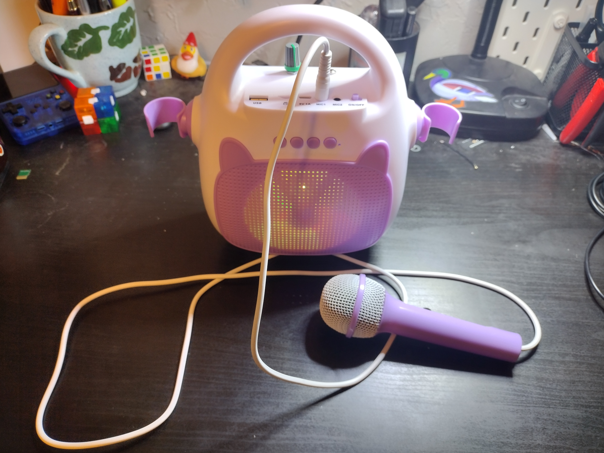
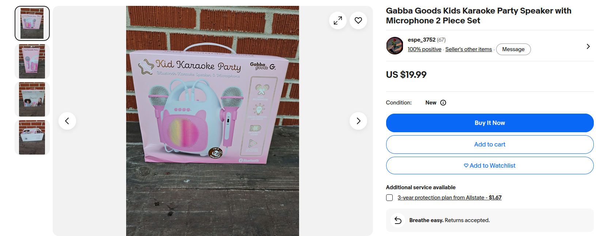
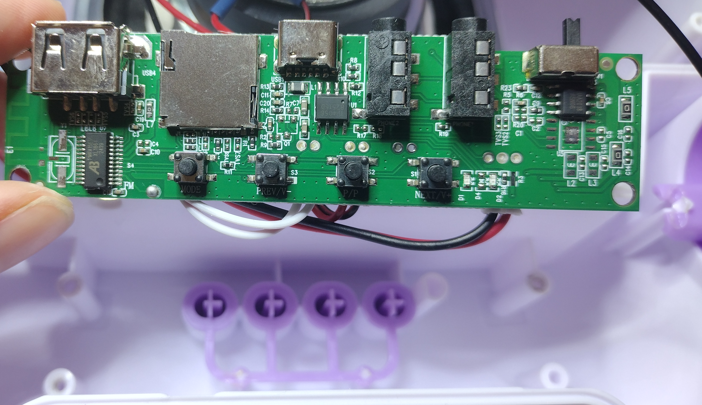
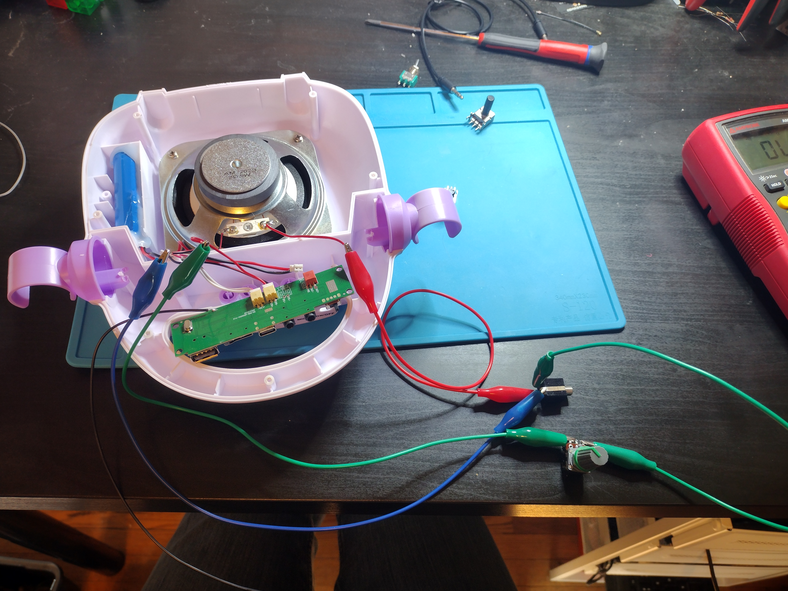
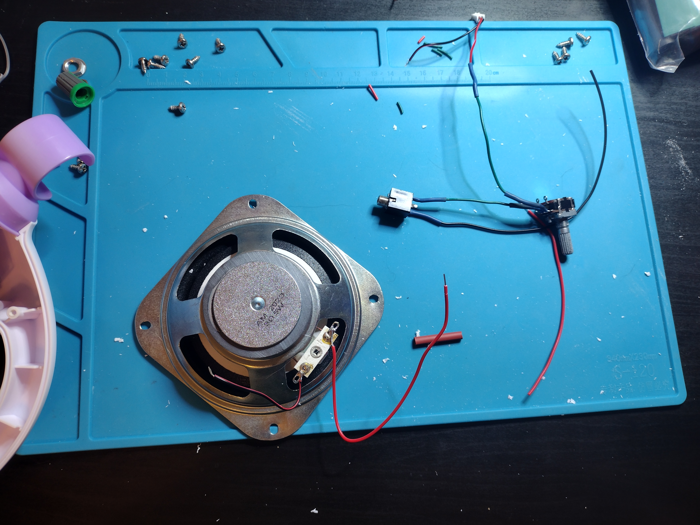
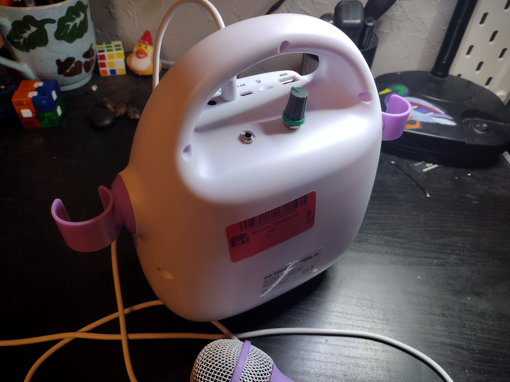
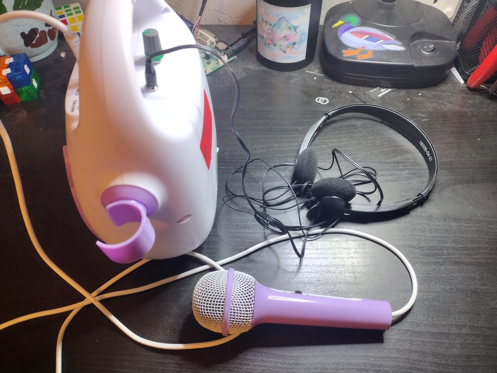

* TOC
{:toc}

Designing circuits from scratch or using existing dev boards to cobble a finished product together is fun and fascinating. But sometimes, you want a different sort of challenge. [Circuit bending](https://en.wikipedia.org/wiki/Circuit_bending) is the process of modifying an already existing circuit in order to output weird, glitchy, or fun stuff, using added buttons, switches, or other interfaces. So basically you're doing reverse-engineering and then circuit building, all in a very constrained space and with a weird package you have no control over. Sounds fun, right?!

Well I found something I thought had potential, and started playing around with it. I've got some first steps done, and hope to do another post later with some interesting results.

<!--more-->

# The Karaoke Machine

While wandering a thrift store I found this children's Karaoke Machine for a grand total of 3 bucks. I'd been wanting a children's toy that can make noise for a while, so I could open it up and try to mess with it, so this felt like a steal. 

Looking online, this model is not sold by Gabba Goods anymore, but ebay still has some for about 20 dollars, plus shipping.

The basic functionality honestly feels super overpowered for a children's toy, but maybe I'm just old? It has 2 microphones with on/off switches, with a built-in speaker that can take audio from: FM radio, a micro SD card inserted into it, a USB thumbdrive inserted into it, OR via a bluetooth connection from a phone. The audio from the microphone by default has an echo-y reverb applied to it. And of course, it looks like a cat, and has a flashing LED on top of the speaker.

# The Eventual Plan

I'd like to see if I could either a) take away the reverb on the microphone, or b) make it even jankier sounding. If I then added an alternative output than the speaker, I could feed that sound into audio recording or other musical devices, and use it for making fun music. The idea of having a children's cat karaoke machine for making music just entertains me, so it'd be fun to try and make that happen.

I don't have much experience with circuit bending, but the basic idea is that you open it up, do some reverse engineering to figure out where the important bits are, and then try adding new connections, disconnecting things, etc. to figure out what you can make it do.

# First Steps

First things first: I want to be able to plug in headphones to mute the speaker. If I'm doing circuit bending, I may make a lot of annoying noises. Much like the [Atari Punk Console](), my partner probably wouldn't appreciate that on work from home days. So! I can use my Punk Console practice to add a headphone jack to this too. And since I'm in there, I decided to add a volume knob. The karaoke machine has a volume control by pressing and holding buttons on the front panel, but they feel slow to respond and not as useful as a volume knob. 

Time to break it open!

The back is simply a series of philip screws, so it's easy to open up. Once inside, there's only one PCB, and a separate speaker and LED. Everything else is all in one place.

There's a couple ICs, a couple buttons, the microhpone jacks, and the USB/microSD/USB-C connectors. Pretty straightforward! Most likely one of the ICs is an all-in-one custom "Bluetooth/FM Radio Audio microcontroller" (probably the lower left one that has lots of pins), with the others being related to power management...and maybe an amplifier? I'll have to research the numbers on the ICs and see if any of them have datasheets...

## Headphone Jack

Now that we've poked around a bit, let's add the headphone jack! The speaker connection is pretty obvious, a red and black wire running to the speaker from the main PCB. Like the Atari Punk Console, I'll be using a switching headphone jack in-series with the speaker. This will let me use the headphone jack and disable the speaker, but leave the speaker working when I unplug my headphones. I'll also have a potentiometer in-series to act as a volume control for the headphones and speaker. 

For some reason my brain always forgets how to connect switching headphone jacks and I have to reason it out from first principles each time. I drew out my planned changes and made notes so I could remember which things to solder to which.

> **NOTE** The eagle-eye viewer may have noticed I drew the pot connections wrong. The arrow needs to be connected to the headphone jack, since that's the wiper part of the pot that makes it a variable resistance. I knew what I meant, though, and connected it the right way.

After that, it was time to be brave and start cutting wires! I disconnected the speaker entirely (cutting both the black and red wires. Nothing exploded so I cut the right ones). Then I used my trusty alligator clips to connect the headphone jack and the volume control in my planned setup. I could then power on the karaoke machine and verify things worked as expected. I turned it on, and no magic smoke came out, yay!

I wasn't sure which potentiometer would work best for the volume control, so I used the classic technique: "Try a bunch and see what works". I almost picked the wrong one until I realized I should set the volume on the machine to max with press-and-hold button on the front of it, and _then_ try using the pot to control volume. Otherwise I was making an already quiet output too quiet. I eventually settled on the 10K pot that even had a knob for it, so it could look pretty once I finished.

With that confirmed, I could move on to soldering! The speaker wires were quite thin, and I didn't have quite the same gauge, but I did have some 22AWG Solid Core hookup wire from adafruit in many colors, so I used the red, green, and black wires to keep things organized. And, of course, some heatshrink to cover connections.

Now, this gave me two new holes I needed to add to the plastic case: One for the headphone jack, and one for the shaft of the pot. I decided to add them to the back half of the plastic case, and used an xacto knife and some mini files to cut through the plastic and make smooth round holes for them to slide into. My desk... is now covered in pink-white plastic. You can see some of that in the last photo. Such is life.

Happily, both the headphone jack and the pot had the correct nuts on them so I could screw them onto the plastic case. A lot of my individual components come from Axman surplus, so they don't always have those, and I have to mount them in other ways. 

Once everything was connected, I had to move the wires around to carefully close it up. The new wires coming from the speaker to the PCB part of the plastic case needed extra room, so I had to file a larger slot in the plastic where the existing battery wires and speakers came through. The solid core wires are also less bendy than the multistranded wire, so it was harder to curl them up to fit in the case without getting in the way of the seams on the plastic case. After a bit of finagling, though, I suceeded!

# Next Steps and Conclusion

Alright! Next steps are going to be some research into the ICs and some poking around by hand on the board with my headphones in, and see if I can get anything interesting sounding. If I do, I'll see about adding a switch or button so I can trigger the interesting sounds by demand. But for now, my first tweaks open up some new possibilities for me as I play around with it, and I want to rest on my laurels a bit.