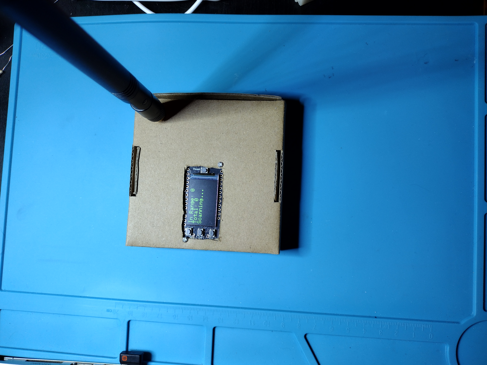
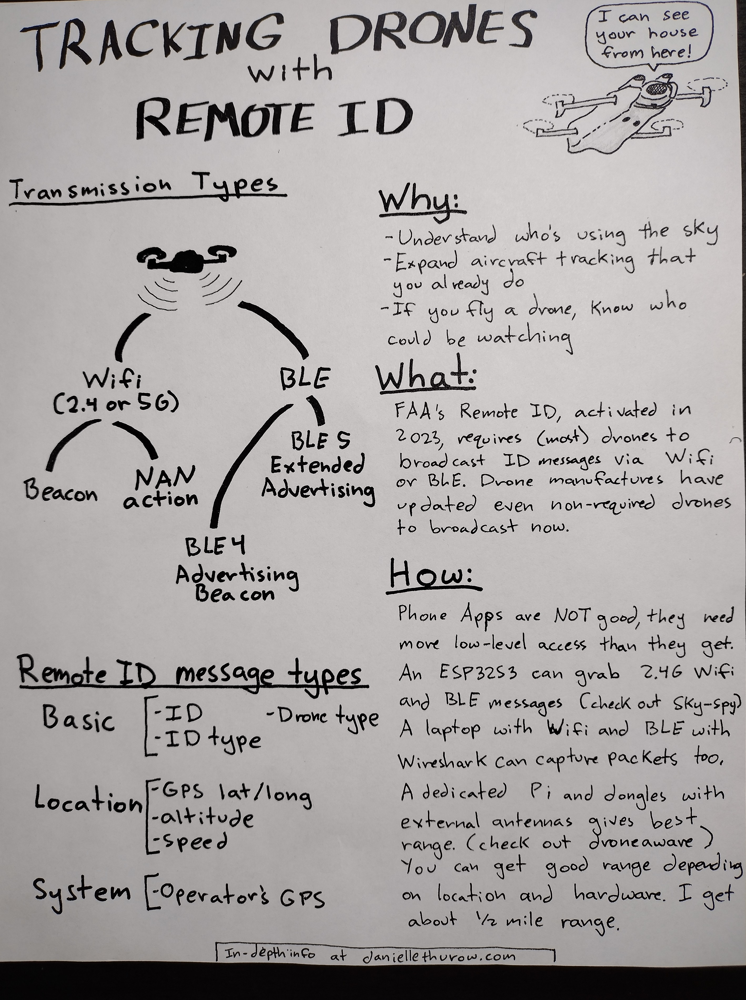
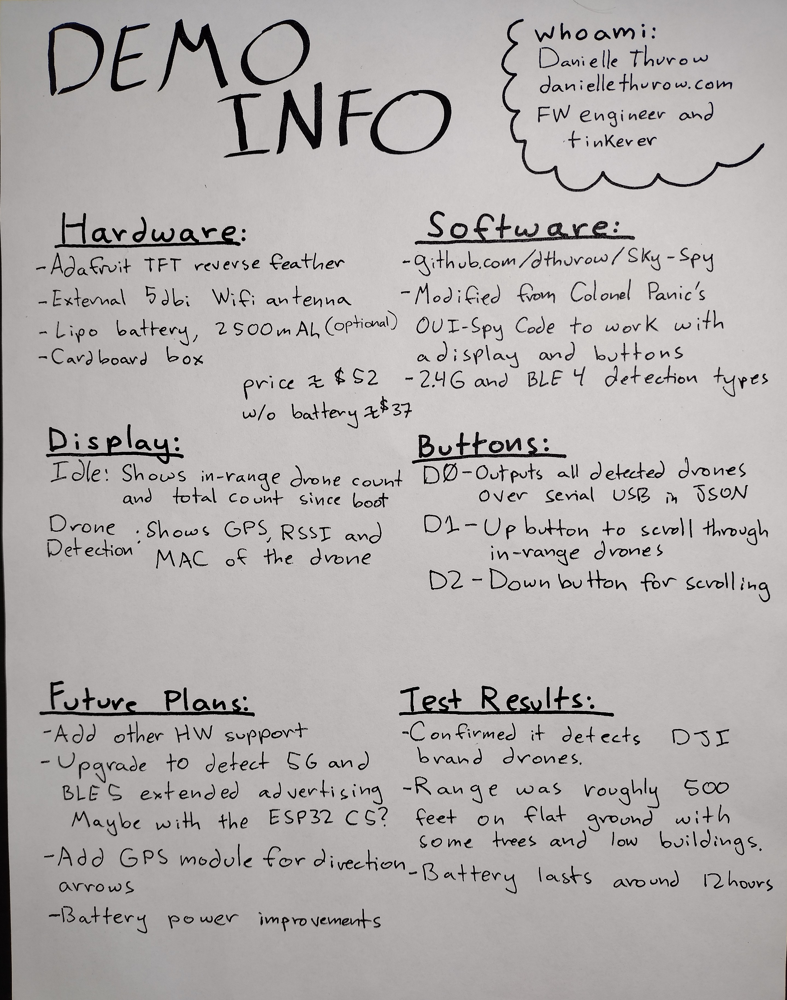

Since the [previous blog post]() talked about the Remote ID protocol and how it was broadcast, you might now want to actually _listen_ to those Remote ID messages around your home. There's certainly commercial-grade solutions for that, but maybe you don't want to drop a thousand dollars or book a meeting with a company so you can buy it, all for a fun sidequest. Instead, lets look for some slightly cheaper and easier to access options, and see what Remote ID functionality they support, and what they don't. Also including some forked code that I've started working on!

<!--more-->

> **NOTE** Highly recommend reading my previous post about the remote ID transmission types, if you haven't already. This post assumes you know about that already.

## Colonel Panic Sky-Spy

[Colonel Panic](https://colonelpanic.tech/) has several fun pieces of hardware, including their OUI-SPY, which was originally setup as a general BLE scanner, but was re-purposed by them as a drone detector as well. They used their hardware with a custom code base called [Sky-Spy](https://github.com/colonelpanichacks/Sky-Spy). This was the first drone detection hardware I came across.

The custom hardware currently runs on the Xiao ESP32-S3, and only scans BLE 4 and 2.4GHz. It does check for Wifi NAN and beacon frames though, so it covers 3 out of possible 6 transmission types. How do I know? By looking at the current hardware and firmware. 

#### BLE 4 and 5

For BLE, we can see it's using pretty standard espressif setup for BLE advertisements (in fact, looks like pretty much just a copy+paste). However, it's not setup for the BLE 5 extended advertising packets, which we can see by looking at the BLE 5 example code from espressif.

The main Sky-spy code can be found here: [https://github.com/colonelpanichacks/Sky-Spy](https://github.com/colonelpanichacks/Sky-Spy)

Here's the callback:
```c++
class MyAdvertisedDeviceCallbacks : public BLEAdvertisedDeviceCallbacks {
public:
  void onResult(BLEAdvertisedDevice device) override {
    int len = device.getPayloadLength();
    uint8_t* payload = device.getPayload();
    // payload parsing removed here for brevity...
  }
};
```

And the BLE initialization:
```c++
  BLEDevice::init("DroneID");
  pBLEScan = BLEDevice::getScan();
  pBLEScan->setAdvertisedDeviceCallbacks(new MyAdvertisedDeviceCallbacks());
  pBLEScan->setActiveScan(true);
```

The Espressif example code for extended advertising, meanwhile, is here:
https://github.com/espressif/arduino-esp32/blob/master/libraries/BLE/examples/BLE5_extended_scan/BLE5_extended_scan.ino

Here's Espressif's callback, note it's implementing a different class's `onResult`, the `BLEExtAdvertisingCallbacks` class:
```c++
class MyBLEExtAdvertisingCallbacks : public BLEExtAdvertisingCallbacks {
  void onResult(esp_ble_gap_ext_adv_report_t report) {
    if (report.event_type & ESP_BLE_GAP_SET_EXT_ADV_PROP_LEGACY) {
      // here we can receive regular advertising data from BLE4.x devices
      Serial.println("BLE4.2");
    } else {
      // here we will get extended advertising data that are advertised over data channel by BLE5 devices
      Serial.printf("Ext advertise: data_le: %u, data_status: %u \n", report.adv_data_len, report.data_status);
    }
  }
};
```

And here's the initialization, note it's setting the extended scan functions:
```c++
 BLEDevice::init("");
  pBLEScan = BLEDevice::getScan();  //create new scan
  pBLEScan->setExtendedScanCallback(new MyBLEExtAdvertisingCallbacks());
  pBLEScan->setExtScanParams();         // use with pre-defined/default values, overloaded function allows to pass parameters
  delay(1000);                          // it is just for simplicity this example, to let ble stack to set extended scan params
  pBLEScan->startExtScan(scanTime, 3);  // scan duration in n * 10ms, period - repeat after n seconds (period >= duration)
```

So this comparison shows that Sky-Spy is capturing the BLE standard advertising packets, but not the extended ones. However, the espressif example appears to get both legacy and extended advertising, which means this hardware could actually capture both. I plan on looking into this for my custom fork of this code (more below).


#### 5G Wifi

For determining if it supports 5G, we just have to look at the ESP32-S3 hardware fact sheet to see it does not support 5G wifi. The ESP32S3 only has 2.4 GHz Wi-Fi (IEEE 802.11b/g/n) and Bluetooth® 5 (LE). The new [ESP32-C5](https://www.espressif.com/en/products/socs/esp32-c5) _does_ support 5GHz wifi, and according to Espressif is the "first RISC-V MCU that supports 2.4 and 5 GHz dual-band Wi-Fi 6, along with Bluetooth 5 (LE) and IEEE 802.15.4 (Zigbee, Thread) connectivity". So this may be a hardware upgrade for the future.


#### 2.4G Wifi

And we can see in the codebase that it parses both the NAN and beacon wifi frames. First, the initialization, setting up the wifi module to be in promiscuous mode and scanning Channel 6:

```c++
  WiFi.mode(WIFI_STA);
  WiFi.disconnect();
  
  esp_wifi_set_promiscuous(true);
  esp_wifi_set_promiscuous_rx_cb(&callback);
  esp_wifi_set_channel(6, WIFI_SECOND_CHAN_NONE);
```

The `callback` function it references checks the packets to see if they're NAN or beacon and parses them as needed. The first `if` statement short circuits if the wifi packet isn't a management packet. It then checks if the destination address is the NAN address, or if the management frame's type is `0x80`, the beacon type.

```c++
void callback(void *buffer, wifi_promiscuous_pkt_type_t type) {
  if (type != WIFI_PKT_MGMT) return;
  
  wifi_promiscuous_pkt_t *packet = (wifi_promiscuous_pkt_t *)buffer;
  uint8_t *payload = packet->payload;
  int length = packet->rx_ctrl.sig_len;
  
  static const uint8_t nan_dest[6] = {0x51, 0x6f, 0x9a, 0x01, 0x00, 0x00};
  if (memcmp(nan_dest, &payload[4], 6) == 0) {
    if (odid_wifi_receive_message_pack_nan_action_frame(&UAS_data, nullptr, payload, length) == 0) {
      // parsing removed for brevity...
    }
  }
  else if (payload[0] == 0x80) {
   // parsing removed for brevity...
  }
}
```


#### Parsing Remote ID protocols

Something I like about this codebase is that it uses the open remote ID library: [https://github.com/opendroneid/opendroneid-core-c](https://github.com/opendroneid/opendroneid-core-c) for parsing the received messages. This parsing library was originally put together by Gabriel Cox, who was "leading the ASTM UAS Remote ID workgroup (as Chairman) consisting of industry and government stakeholders to bring a consensus standard solution and Means of Compliance (MOC) for Remote ID." (quote pulled from [his company website](https://coxdatalabs.com/about/)). It also claims in the README to be compliant with the updated F3411-22a, the version of the specification that currently does not appear to be available online unless you pay ASTM for the pleasure.


### Setup with DIY Hardware

When I was first interested in this, the [official OUI-Spy Hardware](https://colonelpanic.tech/) was estimated a month or so out. However, Digikey sells the parts that Colonel Panic mentions as a DIY option, and has a much faster turnaround. So with a little bit of perf board and soldering, I had a functionally-identical bit of hardware that cost roughly 10 dollars and arrived faster. Downside, of course, is that I had to do a lil bit of soldering and firmware flashing. Luckily, that's my jam. 

I picked up a 3-pack of the ESP32S3's, since it was a bit cheaper per-board: [https://www.digikey.com/en/products/detail/seeed-technology-co-ltd/102010573/24814471](https://www.digikey.com/en/products/detail/seeed-technology-co-ltd/102010573/24814471)

And piezo buzzers are pretty interchangeable, but I grabbed these: [https://www.digikey.com/en/products/detail/tdk/PS1720P02/935932](https://www.digikey.com/en/products/detail/tdk/PS1720P02/935932)

I then followed the notes in Colonel Panic's README to wire up the correct pins on the dev board to the piezo buzzer, and soldered it all together on a piece of perf board. Below are some pictures of my final product! Note I've added a larger antenna as my external antenna for the Wifi, since I had one lying around. You can just use the small antenna that comes with the Xiao ESP32S3, you'll probably just get a smaller range with it.


And the back side to see my "better than good, it's good enough" soldering on the bit of perf board I used:


## My Modified Codebase

I forked Colonel Panic's codebase and started adding support for other hardware types. Codebase is [here](github.com/Dthurow/Sky-Spy). So far I've added support for the Adafruit TFT reverse feather, which also gives a display to play with, to show drone detections immediately. I plan on adding a couple more hardware options, as well as upgrading the codebase to support both legacy and extended advertising BLE packets. I may also take some of the code changes from the [Flock-you](https://github.com/colonelpanichacks/flock-you) codebase that Colonel Panic also made. Mainly writing to memory for detection retention through power-loss.


Here's a link to the hardware list on adafruit: [https://www.adafruit.com/wishlists/622656](https://www.adafruit.com/wishlists/622656). The total is about 48 dollars, but if you want to skip the battery, or buy the internal antenna option, you could cut the price down considerably. Though this comes with funcitonality trade offs, of course.

A nice benefit from using the Adafruit TFT reverse feather is that it comes with a battery charger chip onboard, and a JST connector for a lipoly battery. Which means it's super easy to power with _either_ an external USB-C connector, or with an internal battery, for portability. I'm currently using the very advanced prototyping functionality of "cardboard boxes" to create a custom enclosure for this hardware, but someone with 3d printing knowledge could probably knock out a slick case for it pretty fast. 

Here's some pictures of that current setup:




> **NOTE** I took this custom setup to [Teardown 2026](https://www.crowdsupply.com/teardown/portland-2026) and just had it out on a table with little infographics for part of the conference. I've included the infographic images below if you're curious!



## Droneaware

Droneaware is designed to be more of an "ADSB feeder, but for drones" design. Its node setups use a raspberry pi and off the shelf wifi and bluetooth dongles, with a couple scripts that parse any scanned results, and feed them to both a local webserver and the shared [droneaware live map](https://droneaware.io/live.html), aggregating everyone's data.


#### BLE 4 and 5

Droneaware uses Bleak for scanning, which on linux, uses BlueZ as the backend.

#### 5G Wifi

#### 2.4G Wifi

#### Parsing Remote ID protocols

### Setting up DroneAware

#### Verify wifi dongle
The internal wifi is used by both the ADSB and droneaware to talk to the internet, so I can't use that for scanning for drones. Instead, I need a wifi dongle that supports promiscuous and monitor mode on linux, allowing me to scan for any wifi packets flying through the air.


To verify it runs on linux, I plugged it into my linux laptop and ran `ifconfig` with and without wireless USB plugged in to get the interface name: `wlx9cefd5f644bd`

Then I verified it can work with monitor mode by resetting it to monitor mode via below:
```bash
$ sudo ifconfig wlx9cefd5f644bd down
$ sudo iwconfig wlx9cefd5f644bd mode monitored
$ sudo ifconfig wlx9cefd5f644bd up
```

Then ran wireshark and captured packets [here](/assets/drones/monitor_mode_panda.pcapng) to verify it was picking up everything.

Lastly, reset it back to the regular mode:
```bash
$ sudo ifconfig wlx9cefd5f644bd down
$ sudo iwconfig wlx9cefd5f644bd mode managed
$ sudo ifconfig wlx9cefd5f644bd up
```

#### Install onto ADSB server

setup root ssh on my adsb.im raspberry pi by going to the homepage of the feeder, then go to System -> Management. Click "Show Password" for it to generate a new root user password, save it, then accept. You can now remote into your raspberry pi if you're on the same network by doing the `ssh root@<your ip>` command, and typing in the root user password you saved earlier.

Once on your pi, you can run the install script:

```bash
curl -fsSL https://github.com/fduflyer/DroneAware-Node-Releases/releases/latest/download/install.sh | sudo bash
```

> Note: you can see the release source code on github [https://github.com/fduflyer/DroneAware-Node-Releases](https://github.com/fduflyer/DroneAware-Node-Releases) by downloading the zip of the source code. There you can see the python scripts that run the wifi and ble detection services. So you don't have to install things blindly here, if you don't want to


You can check if it finishes install and is running by using systemctl:
```bash
sudo systemctl status droneaware-wifi
sudo systemctl status droneaware-ble
```

There's also a `droneaware` command that gets installed, that has a few subcommands:
```
Commands:
  update       Download and install the latest firmware
  status       Show service status and firmware version
  logs         Tail live logs  (wifi by default, or: droneaware logs ble)
  test         Transmit a 60-second test flight and verify detection
  test --dry-run  Check rate-limit availability without transmitting
```

## Current detections

- droneaware - only detecting via beacon frames, up to about 1 mile out. There's been an occasional outlier at 2 miles, but it's often single pings and with weirdly high altitude readings, so it's unclear if those are faulty readings.

- sky-spy - can detect drones about 500 feet or so away, in relatively flat, low buildings and some trees area.

# References

Droneaware: [https://droneaware.io](https://droneaware.io)

Colonel Panic: [https://colonelpanic.tech/](https://colonelpanic.tech/)

Sky-Spy: [github.com/colonelpanichacks/Sky-Spy](github.com/colonelpanichacks/Sky-Spy)

Custom codebase: [github.com/Dthurow/Sky-Spy](github.com/Dthurow/Sky-Spy)

Adafruit TFT reverse feather drone kit: [https://www.adafruit.com/wishlists/622656](https://www.adafruit.com/wishlists/622656)

open remote ID library: [https://github.com/opendroneid/opendroneid-core-c](https://github.com/opendroneid/opendroneid-core-c)

Monitor mode wifi dongles: [https://www.acrylicwifi.com/en/wifi-analyzer/requirements-and-compatibility/](https://www.acrylicwifi.com/en/wifi-analyzer/requirements-and-compatibility/)

linux wifi dongles: [https://github.com/morrownr/USB-WiFi/blob/main/home/USB_WiFi_Adapters_that_are_supported_with_Linux_in-kernel_drivers.md#ac1200--ac1300---usb-3---24-ghz-and-5-ghz-wifi-5](https://github.com/morrownr/USB-WiFi/blob/main/home/USB_WiFi_Adapters_that_are_supported_with_Linux_in-kernel_drivers.md#ac1200--ac1300---usb-3---24-ghz-and-5-ghz-wifi-5)


Setting up a flightaware raspberry pi with droneaware: [https://droneaware.io/flightaware.html](https://droneaware.io/flightaware.html)

Setting a wifi interface to monitor mode: [https://www.geeksforgeeks.org/linux-unix/how-to-put-wifi-interface-into-monitor-mode-in-linux/](https://www.geeksforgeeks.org/linux-unix/how-to-put-wifi-interface-into-monitor-mode-in-linux/)

