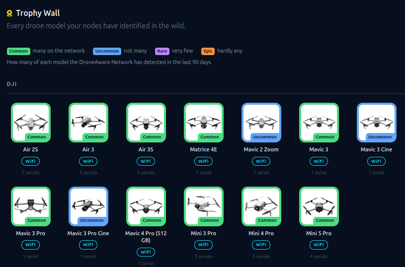

* TOC
{:toc}


The next setup for tracking Remote IDs I want to take a dive into is [droneaware](https://droneaware.io). Droneaware is designed to be more of an "ADSB feeder, but for drones" than a standalone device like Sky-Spy. Its node setups use a raspberry pi and off-the-shelf wifi and bluetooth dongles, with a couple scripts that parse any scanned results, and feed them to both a local webserver and the shared [droneaware live map](https://droneaware.io/live.html), aggregating everyone's data.


<!--more-->


> **NOTE** They're pretty active with development, so some of my research may be moot soon. **BUT** if you know how and where to look for this info now, you'll be able to take a look at the latest code and compare!

## Overview - Functionality and Code Review


> **NOTE** want to follow along? The code is at [https://github.com/fduflyer/DroneAware-Node-Releases](https://github.com/fduflyer/DroneAware-Node-Releases)

### BLE 4 and 5
The dongle I'm currently using is the Parani-UD100, which only supports bluetooth 4.0, so it it doesn't support the BLE 5 extended advertising.

Droneaware uses Bleak for scanning, which on linux, uses BlueZ as the backend. If you've used BlueZ on linux for things, then you know... poking around here gets confusing fast.

Bleak talks with BlueZ via the d-bus, an inter-process communication program on linux. From Bleak's github, you can see a [issue with telling if an advertising packet is extended or not](https://github.com/hbldh/bleak/issues/1347). Basically, Bleak doesn't clarify if an advertisement is extended or not, BUT, it's talking with BlueZ. So then the question is: does BlueZ support BLE 5 extended advertising? And after digging into this for a while, the answer seems to be: _probably_. 

Which is an annoying answer to have.

The current [BlueZ website](https://bluez.github.io/) says it has "support for Core Specification features up to 6.0", so that should include extended advertising. But if you download the code and do some grepping around [https://github.com/bluez/bluez](https://github.com/bluez/bluez), a lot of places that you would think should have support for extended advertising (e.g. `le_adv_report_evt` that `btmon` uses to display HCI events), there isn't an extra line for extended advertising. 


So at some point I realized that I'd been once again nerdsniped to learn about the innards of BLE implementation on linux. I'm going to put a pin on that research and draw a conclusion for droneaware functionality: It should support extended advertising if the BLE dongle you buy supports it. But you'll probably want to do some testing to be sure.


### 5G and 2.4G Wifi

If the wifi dongle has support for 5G, and if you have two wifi dongles attached, droneaware will actually set one to 5G exclusively, and the other to 2.4G, which is pretty neat!


There's two places you can see how that happens. 

First place is in the `droneaware` bash script that contains the code for the command line commands (e.g. `droneaware status` code is here). You can see the logic for finding the wifi dongles in `_classify_wifi_adapters`.

Basically, it runs a python script, that uses the `ip` and `iw` commandline commands, plus various regex expressions, to determine if an interface is a USB dongle, and also if it supports the 2.4G and/or 5G bands. 

Excerpt that calls `iw`:

```python
r = subprocess.run([IW, "phy", phy, "info"],
                     capture_output=True, text=True, timeout=5)
a["bands"] = _bands(r.stdout)
```

Then the `_bands` function that parses the output from `iw`:

```python
def _bands(info):
    # iw frequency format varies by version and the old pattern required a
    # decimal that Bookworm's iw 5.19 does not print:
    #   iw 6.9  (trixie)   * 2412.0 MHz [1]
    #   iw 5.19 (bookworm) * 2412 MHz [1]
    # Requiring the decimal returned no bands at all on the supported
    # platform, so no adapter roles were assigned. Bullet and decimal are
    # both optional now. Keep in sync with _wclassifier_parse_bands in
    # wifi_feeder.py — the CLI and the feeder must agree about the hardware.
    b = set()
    for line in info.splitlines():
        m = re.search(r"(\d{4})(?:\.\d+)?\s+MHz\s+\[\d+\]", line)
        if m:
            f = int(m.group(1))
            if 2400 <= f <= 2500: b.add("2.4")
            elif 5000 <= f <= 6000: b.add("5")
    return sorted(b)
```


The python script then prints out strings that would create bash variables in a bash script. Well suprise, `_classify_wifi_adapters` _is_ in a bash script!

Here's the python script `print` commands in the script inside `_classify_wifi_adapters` bash function:
```python
print(f"MONITOR_COUNT={len(monitor)}")
print(f"ROLE_2G_MAC={role_24g['mac'] if role_24g else ''}")
print(f"ROLE_5G_MAC={role_5g['mac'] if role_5g else ''}")
```

So in the `droneaware` bash file, functions that call `_classify_wifi_adapters` will do an `eval` on the results of `_classify_wifi_adapters`, which then sets the appropriate bash variables inside the calling function. So an example, `_classify_wifi_adapters` is called in  `_orchestrate_wifi_mode`:

```bash
    local MONITOR_COUNT="" ROLE_2G_MAC="" ROLE_5G_MAC="" RESERVED_MACS=""
    eval "$(_classify_wifi_adapters 2>/dev/null)"
```

After these two lines, the `MONITOR_COUNT`, `ROLE_2G_MAC`, `ROLE_5G_MAC` and `RESERVED_MACS` bash variables will be populated by the printed results from the python script running inside `_classify_wifi_adapters`. Weird, right?!


> **NOTE** This is because bash is based on Clarke's Law: "Any sufficiently advanced bash script is indistinguishable from magic"


You can also see some code for determining 5g and 2.4g support in `wifi_feeder.py`'s `wclassifier_enumerate` function

```python
    result = []
    links = _network_link_ifaces()
    for path in sorted(glob.glob("/sys/class/net/wlan*")):
        iface = os.path.basename(path)
        a = {
            "iface": iface,
            "mac": _wclassifier_read(f"{path}/address") or "?",
            "driver": _wclassifier_readlink_base(f"{path}/device/driver") or "?",
            "bus": _wclassifier_readlink_base(f"{path}/device/subsystem") or "?",
            "usb_vid": None, "usb_pid": None, "phy": None,
            "bands": [], "supports_monitor": False, "classification": "unknown",
        }
        if a["bus"] == "usb":
            a["usb_vid"] = _wclassifier_read(f"{path}/device/../idVendor")
            a["usb_pid"] = _wclassifier_read(f"{path}/device/../idProduct")
        a["phy"] = _wclassifier_read(f"{path}/phy80211/name")
        if a["phy"]:
            try:
                info = subprocess.run(
                    [_IW_PATH, "phy", a["phy"], "info"],
                    capture_output=True, text=True, timeout=5
                ).stdout
                a["bands"] = _wclassifier_parse_bands(info)
                a["supports_monitor"] = bool(
                    re.search(r"^\s*\*\s+monitor$", info, re.MULTILINE)
                )
            except (subprocess.TimeoutExpired, FileNotFoundError):
                pass
```

And the corresponding parsing of the bands:

```python
    bands = set()
    for line in iw_info.splitlines():
        m = re.search(r"(\d{4})(?:\.\d+)?\s+MHz\s+\[\d+\]", line)
        if not m:
            continue
        freq = int(m.group(1))
        if 2400 <= freq <= 2500:
            bands.add("2.4")
        elif 5000 <= freq <= 6000:
            bands.add("5")
    if not bands and iw_info.strip():
        # Non-empty iw output that yielded no frequencies means the format
        # changed again. Say so: an empty band list is otherwise silent and
        # surfaces only as two contradictory warnings ("2.4GHz-only" AND
        # "5GHz-only" for the same adapter), which is how this went
        # undiagnosed in the field.
        log.warning(
            "[classifier] could not parse any frequencies from iw output — "
            "band detection unavailable, adapter roles may be wrong. "
            "Check `iw phy <phy> info` formatting for this iw version."
        )
    return sorted(bands)
```

> **NOTE** It's interesting the code in each place is slightly different and not a copy and paste job. I'd guess either there's been iterations in one place and not the other, or, since this is AI-supported, AI generated slightly different functions in the different locations. 

Either way, Droneaware sets the wifi interfaces to monitor mode by just running bash commands from python:

```python
"""Bring interface up in monitor mode."""
    _ensure_monitor_safe(iface)
    log.info(f"Setting {iface} to monitor mode...")
    subprocess.run(["rfkill", "unblock", "all"], check=False, capture_output=True)
    subprocess.run(["ip", "link", "set", iface, "down"],  check=True)
    subprocess.run(["iw", "dev", iface, "set", "type", "monitor"], check=True)
    subprocess.run(["ip", "link", "set", iface, "up"],   check=True)
    log.info(f"{iface} is now in monitor mode")
```


Then creates a socket listening to packets coming from the wifi interface, which then parses the data as needed.


### Parsing Remote ID protocols

Droneaware uses custom parsing included in the `ble_feeder.py` and `wifi_feeder.py` in the `decode_rid_message` function to parse the Basic ID, Location, System, Operator ID, and pack message types. As of this writing, the Wi-Fi NAN Remote ID is still not parsed in the code, and I'm not entirely sure why, since it's so similar to the beacon frame, which _is_ parsed in `wifi_feeder.py`. Maybe a forgotten TODO?


### Some Cons

One con for someone like me who likes to modify the code I run, is the current licensing that droneware runs under. Exact snippet:

```md
RESTRICTIONS

1. Prohibited Uses. You may NOT:
   a. Modify and redistribute this Software as a Competing Service or
      competing product.
   b. Use this Software to build, support, or operate a Competing Service.
   c. Sublicense, sell, rent, lease, or otherwise commercially exploit
      this Software.
   d. Remove, alter, obscure, or replace any copyright notice, branding,
      or attribution contained in this Software.
   e. Reverse engineer, decompile, or disassemble the compiled binaries
      except to the extent permitted by applicable law.

2. Network Restriction. This Software may only be used to transmit data to
   DroneAware-operated services. Use of this Software with any Competing
   Service or third-party data aggregation system is strictly prohibited.

3. No Forking for Competing Use. You may not create derivative works of
   this Software for the purpose of building or operating a Competing
   Service.
```

I run an ADSB feeder that feeds multiple websites, but based on the current licensing above, I couldn't try modifying the current pi-side code here to upload to other drone detector aggregators. Now, I don't actually know of any other aggregator websites, but gosh darnit, I want to have that ability if we get more options in the future. But as of right now, this is locked in.

> **NOTE** You may notice, this license also prohibits reverse engineering/decompiling/disassembly of binaries. All code snippets and reviews are on the un-compiled python scripts included in the release, so I'm not doing those things. Just if you were worried.


Another issue is that the data is mostly aggregated and sent up to the server side of things. Having a local copy of all detections is not as supported out of the box, and feels a bit clunky. There's a `/run/droneaware/detections.jsonl` file that keeps detections for the last 60 minutes or so, and  from v1.6, the node also keeps its own detection history on the SD card in the folder `/var/lib/droneaware/spool`. But neither of these are easily accessible on the droneaware website or on the local viewer, so you have to do your own shenanigans to get and keep detections. This feels a little nit-picky, but since the droneaware website is partially about getting enough data to start selling it to others (similar to adsb trackers), I want a little easier access to my own data.

> **NOTE** Since writing this, I've learned the CSV download for your personal nodes has moved into the `Settings` menu on the droneaware website. This makes shenanigans feel less likely, but it does still feel a bit hidden.


### Droneaware Functionality Conclusion

The initial setup and slick local web viewer plus online aggregator is really nice. If you _don't_ want to muck about with looking at python and bash, or you want to contribute to a shared aggregator that others can use without building their own nodes, Droneaware is really nice. The discord server they have is also quite active with a lot of help from the developer, so if you run into issues, you can probably get that fixed quickly!

Because it's currently the only game in town for crowd-sourced drone aggregators, however, I worry that things will get closed off or the data hidden, and people wouldn't be able to stop them. I also worry about how quickly the code iteration is happening with so much vibe-coding. The codebase is getting bigger very fast, when do things start breaking?

> **NOTE** This worry may be because I'm a curmudgeon. Take it as you will.

But in the meantime, I will be running a droneaware node myself, and hope my worries are unfounded. 

## Current Detection Results

So far, my node has been detecting via beacon frames, up to about 1.5 miles out, though normally it's more about a half mile average. It's also only detected DJI drones. 




I think I'd get better range if I could get my antenna up a little higher and move them outside (right now they're just against my window), and I'm curious if I'll be getting more range over the winter, when the nearby trees are all de-leafed (Since "foliage attenuation" is apparently [a thing](https://ieeexplore.ieee.org/document/5765439)). 

It's fun to see the drones that droneaware catches and it's so easy to setup, I'd recommend checking it out yourself!

# References

Droneaware: [https://droneaware.io](https://droneaware.io)

Droneaware Code release: [https://github.com/fduflyer/DroneAware-Node-Releases](https://github.com/fduflyer/DroneAware-Node-Releases)

BlueZ: [https://bluez.github.io/](https://bluez.github.io/)

Foliage Attenuation: [https://ieeexplore.ieee.org/document/5765439](https://ieeexplore.ieee.org/document/5765439)