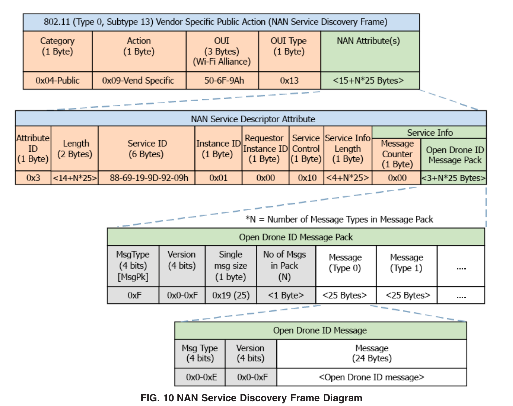
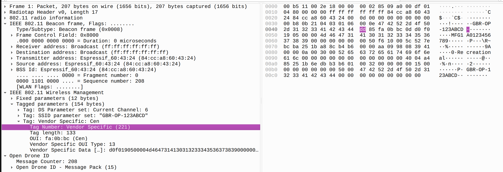
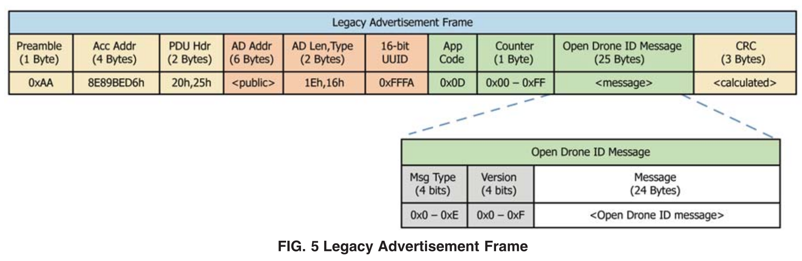
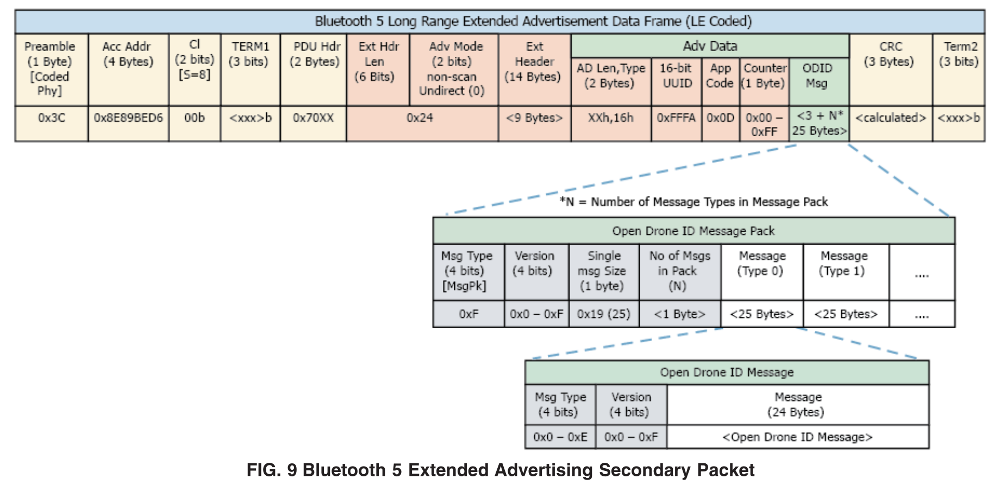
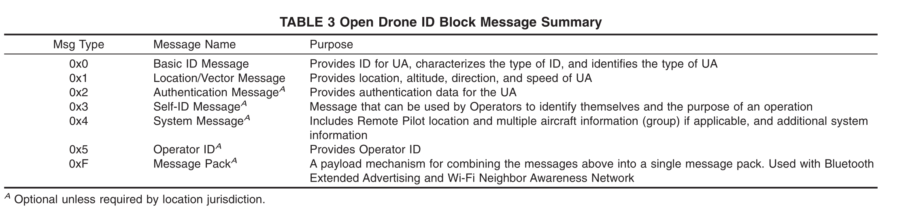

* TOC
{:toc}

Drones have gotten more and more popular lately, from filming fun things on social media, [delivering packages for Amazon](https://www.aboutamazon.com/news/operations/mk30-drone-amazon-delivery-packages), being [used by law enforcements in the states](https://kstp.com/kstp-news/top-news/st-paul-police-new-drones-hit-scenes-in-under-90-seconds-surpass-last-years-drone-flights/), all the way to [being used in the ukraine war](https://www.militarytimes.com/news/pentagon-congress/2026/03/11/these-are-ukraines-1000-interceptor-drones-the-pentagon-wants-to-buy/). Understanding the technology and building tech to _track_ the drones seems very useful. We've had public tracking of airplanes via ADSB for years at this point (see my previous post [about setting up your own flight tracker with ADSB]()), but no equivalent with drones. Partially this is because drones, up until recently, didn't really have ways _to_ track them, unless you were visually tracking them or doing some advanced radio frequency shenanigans. 

That has changed relatively recently (in 2023) when the FAA started requiring Remote IDs for drones, the functional equivalent to the broadcast ADSB info, but for drones specifically. Specific information about the drone, its location, and the drone operator are broadcast in one of the variety of ways specified by the standard put out by the ASTM (a standards governing body), which is charmingly named "F3411". With this new ability, it's possible to start tracking and aggregating drone flight information, same as ADSB. As the FAA website shows (screenshot below), there are now several ways to be compliant with the remote ID requirements, and 2/3rds of the ways require actually broadcasting the info. Lets take a look at this new protocol, and poke around at some sample packets (or generate our own). 


<!--more-->


## Remote ID Basics

Remote ID is the FAA-required ability to send out a drone's information while in flight, including things like: current latitude/longitude, some type of ID, pilot location, height, speed, etc. The actual implementation used by drone manufacturers is defined in the ASTM F3411 standard. It gives specifications for drones to send out data in a couple different ways:

- Wifi NAN discovery frames
- Wifi Beacon frames
- Bluetooth 4.x advertising beacon messages, called “Legacy Advertising” in the ASTMF3411.
- Bluetooth 5  Extended Advertising messages

Since these messages are unencoded, someone with the right software and some wifi and bluetooth dongles can detect these messages. However, in order to do that, you need at least a basic understanding of a lot of different protocols that the remote ID info will be wrapped in, not to mention how the remote ID info is encoded.

So, let's first see what sort of packets are being sent that contain the remote ID info, then look into the remote ID info itself.

> If you prefer to just read the specification directly, you can access the ASTM F3411-19 revision [here](https://thedroneprofessor.com/wp-content/uploads/2022/11/F3411.40165-UAS-Remote-ID.pdf), though there has been a newer revision released in 2022. This does not appear to be accessible for free as of this writing.

## Wifi

Drones will broadcast on channel 6 (2.437 GHz) in the 2.4 GHz frequency band and may optionally operate in channel 149 (5.745 GHz) in the 5 GHz band. From real-world experience so far, it looks like DJIs will broadcast on 2.4GHz, and Skydio drones are more likely to broadcast solely on 5GHz.

> **NOTE** So if you want to listen for wifi remote ID messages, you have to make sure you're listening on those specific channels, otherwise you'll never hear them! This is important, for, say, using wireshark, mentioned below.

### Wifi NAN discovery frames

The NAN discovery frames are actually NAN-specific "public action" Wifi frames. You can narrow this down by looking at the Management Header of a wifi frame first. In there is the "Frame Control" section, which contains the "Type" and "Subtype" fields.To make sure it's an action frame, you'll check if the Type is "management" `0x0`, and Subtype is "action" `0xD`. The "public" part will be verified later in the frame.
After the Frame Control section, there's a destination address. The NAN Network ID specification calls for the destination address in the header to be `51:6F:9A:01:00:00`.

Once it's confirmed it's a Wifi NAN action frame, you can confirm the Category ID is "public" `0x4` in the NAN Service Discovery Header. We now know it's a Public Action NAN frame. But we still don't even know if it's a drone broadcasting a remote ID packet!


For that, we can check this by looking at the OUI and Service ID inside the frame's "NAN Service Discovery Header" and its "Service Descriptor Attribute" section. The OUI in the Service Discovery Header is set to the Wifi Alliance OUI, `50:6F:9A`. 

> OUI stands for Organizationally Unique Identifier and is a 24-bit number that uniquely identifies a vendor, manufacturer, or other organization

And in the "Service Descriptor Attribute" section, the Service ID is the first 6 bytes of a sha of `"org.opendroneid.remoteid"`, which is `88:69:19:9d:92:09`.

> You can confirm the 6 bytes for the Service ID are correct for yourself by hashing it with some python real quick:
```python
>>> blah = hashlib.sha256(b"org.opendroneid.remoteid").digest()[:6]
>>> print(", ".join(hex(b) for b in blah))
0x88, 0x69, 0x19, 0x9d, 0x92, 0x9
```

Here's a screenshot of the F3411 document for the NAN discovery frame. See if you can spot all the values listed above in the frame:



Congratulations, you've now parsed enough to confirm it's a Remote ID Wifi message, and you can start processing the info! Jump down farther in this post to see what's inside. Otherwise, lets switch to a different packet option...

### Beacon 

Another way to send out the remote IDs is via Wifi Beacon frames. These have a different format, and so they need to be parsed differently.

First, take a look at the Management Header of the wifi frame, like last time. Looking in the Frame Control section again, you'll need to verify the Type is "management" `0x0`, Subtype is "Beacon" `0x8`. 

Now this is where the format changes. Inside the Beacon is several required fields, followed by a series of Information Elements that is basically a series of key/value pairs with info the Beacon wants to share. In our case, we want remote ID beacon info. So we need to look through the beacon's Information Element "tags" (which are the keys in the key/value idea), for `0xdd`, the Vendor Specific Information element type. Then verify the start of the info in that tag (the "value" in the key/value idea) is the ASTM OUI, `FA:0B:BC`. We also want to check the type after the OUI is in there and is set to `0x0D`, which indicates a Remote ID app code. 

Here's a screenshot with an example of this packet in wireshark. The left side is the parsed packet with the field names and values, and the right side is the raw packet. Note the type/subtype at the top, the Vendor Specific Information Element type, and the OUI listed there. 



> **NOTE** If you haven't done much with wireshark, highly recommend finding some tutorials and poking around in things. It's amazing for parsing packets of all sorts of protocols, I've found endless use for it, from my web dev days, to now.

The rest of the info in there is a remote ID message, yay!


## Bluetooth

Bluetooth messages are sent over Bluetooth Low Energy (BLE) the most common embedded bluetooth option. The specification supports BLE 4 and 5. 

### Bluetooth 4.x 
BLE 4 uses advertising beacon messages, called “Legacy Advertising” in the ASTMF3411. Advertising messages are sent on a specific set of channels in the bluetooth frequency range, channels 37, 38, and 39, and the beacon messages are simply sending information into the void (not sending to a particular end point), with a small payload. Which in our case, is the Remote ID messages.

To filter down to the remote ID messages, we need to grab all Advertising beacon messages, and check the "AD info" field. That will contain the Mfg Code, which should be `0xFFFA`, the ASTM code. It will also contain the "AD App" field, which should be `0x0D`, for remote ID. The content in this advertising message will be what we want. Here's another screenshot from the ASTM F3411 spec, showing those fields in the packet:



### Bluetooth 5  
Bluetooth 5 Extended Advertisements messages, when sent on a LE Coded (S=8) PHY, can increase the range of the advertisements by a factor of 4, which is why it's so nice. It achieves this by cutting the rate of the data transfer down (with S=8, data rate is 1/8th), where multiple symbols make up 1 bit (with S=8... it's eight symbols per bit), this lets the receiver parse things from a farther distance. 

These Extended advertisements also use a two-step advertisement messages, because it uses the advertisement types `ADV_EXT_IND` and `AUX_ADV_IND`. So  they send advertisements on the normal advertising channels like BLE 4, but those advertisements actually point to larger advertisement packets on other bluetooth channels. This second, larger advertisement frame will have the actual remote ID information. Like the BLE 4 protocol, it will contain the Mfg Code, which should be `0xFFFA` and the "AD App" field, which should be `0x0D`.

Because the secondary advertisement frame is larger, the remote ID information will be sent as a "message pack" type, which combines different remote ID messages into one large packet.




What are these "message pack" and other remote ID message types? I'm glad you asked...

## Remote ID messages

So after all the parsing above, you've finally gotten a Remote ID message. But what's in that message? There's several different type of messages according to the full ASTM F3411:




The main ones we care about when detecting drones though, are just a subset: Basic ID, Location/Vector, System, and Message Pack. Each carry a different subset of data, but can be combined to give a full overview of what the drone and operator are doing.


### Message Pack

This one is easy - it's just a collection of the other messages, so adding support for this is just allowing there to be multiple messages inside a single sent frame (however it was sent). Used in BLE 5 extended advertising messages, since they have the room for it.

### Basic ID

This gives the ID for the drone, and its ID type. E.g. DJI drones will broadcast their Serial numbers as their ID, with ID Type of, you guessed it, "Serial Number (ANSI/CTA-2063-A)". It will also give the type of drone it is, e.g. fixed wing, helicopter/multirotor, etc. Sadly, I have not spotted any drones listing their type as "Airship (such as a blimp)", but maybe someday.

### Location/Vector

This message gives info about the location, altitude, direction, and speed of the drone. One interesting thing to note about altitude, there's a AGL height which is height Above Ground Level. This references from the drone's take-off point, and may not actually be accurate to altitude above the ground where it is actively flying. 

### System

This message gives the operator's latitude and longitude. Depending on how things are setup, this will just default to the drone's take-off location, OR it will be updated dynamically. 


## Using This Info - Wireshark

You've learned a bunch of protocol things, but what can you actually _do_ with it? First and simplest option is to setup a laptop with [wireshark](https://www.wireshark.org/download.html) and [a custom protocol dissector](https://github.com/opendroneid/wireshark-dissector/tree/main) so you can actually capture the packets you just learned about above yourself! You'll need a laptop that can run wireshark, a wifi or bluetooth dongle to capture the packets, and a drone that broadcasts its Remote ID (e.g. a DJI Neo).

> If you want to just play around with packets, the dissector comes with a few pcaps you can load and poke around at. So you would only have to install wireshark and add the dissector. E.g. [https://github.com/opendroneid/wireshark-dissector/blob/main/odid_wifi_sample.pcap](https://github.com/opendroneid/wireshark-dissector/blob/main/odid_wifi_sample.pcap)


The basic steps for this are:

- Install Wireshark, setup so non-root users can capture packets
- Install [custom protocol dissector]((https://github.com/opendroneid/wireshark-dissector/tree/main)), to parse Remote IDs
- Plug a wifi or bluetooth dongle into your computer
    - if it's a wifi dongle, make sure it supports "monitor" mode and set the 2.4GHz channel to "6"
    - other setups can be found in the readme of the protocol dissector
- Run wireshark
- Fly a drone that broadcasts Remote ID on the channel you're lisenting on (e.g. 2.4GHz channel 6)
- Capture packets
- Profit!


On my linux laptop, these commands were useful to setup my wifi dongle, a [Panda PAU0F](https://www.pandawireless.com/pandaAXE3000dualant.html) to monitor mode on channel 6. Note the interface name `wlx9cefd5f644bd` will be different for you, determine by simply running `sudo ifconfig` with the wifi dongle unplugged and then plugged in, and see what interface appears. These commands: take the interface down so I can modify the configuration, set the monitor flag, bring the interface back up, and set it to monitor channel 6.

```bash
sudo ifconfig wlx9cefd5f644bd down
sudo iw wlx9cefd5f644bd set monitor none
sudo ifconfig wlx9cefd5f644bd up

sudo iw dev wlx9cefd5f644bd set channel 6
```

> **NOTE** not all wifi dongles can be set to monitor mode! You'll have to research before you buy. Acrylic wifi has a list of monitor mode dongles that may work with your computer [here](https://www.acrylicwifi.com/en/wifi-analyzer/requirements-and-compatibility/)

## Conclusion

Hopefully this whirlwind overview of the protocols involved in Remote IDs can give you better context for what you'd want to look for when detecting drones via Remote IDs. My next post will most likely be an overview of currently existing drone detection software with their pros and cons, as well as what work I've done personally to expand those options.

## References

Open Drone ID library: [https://github.com/opendroneid/opendroneid-core-c](https://github.com/opendroneid/opendroneid-core-c)

IEEE article with an overview of drone tracking technology and regulations: [https://ieeexplore.ieee.org/document/9861637](https://ieeexplore.ieee.org/document/9861637)

ASTM F3411 Wi-Fi Beacon protocol doc [https://thedroneprofessor.com/wp-content/uploads/2022/11/F3411.40165-UAS-Remote-ID.pdf](https://thedroneprofessor.com/wp-content/uploads/2022/11/F3411.40165-UAS-Remote-ID.pdf)

Setting a wifi interface to monitor mode: [https://www.geeksforgeeks.org/linux-unix/how-to-put-wifi-interface-into-monitor-mode-in-linux/](https://www.geeksforgeeks.org/linux-unix/how-to-put-wifi-interface-into-monitor-mode-in-linux/)

Wireshark dissector of drone IDs [https://github.com/opendroneid/wireshark-dissector/tree/main](https://github.com/opendroneid/wireshark-dissector/tree/main)

Monitor mode wifi dongles: [https://www.acrylicwifi.com/en/wifi-analyzer/requirements-and-compatibility/](https://www.acrylicwifi.com/en/wifi-analyzer/requirements-and-compatibility/)
