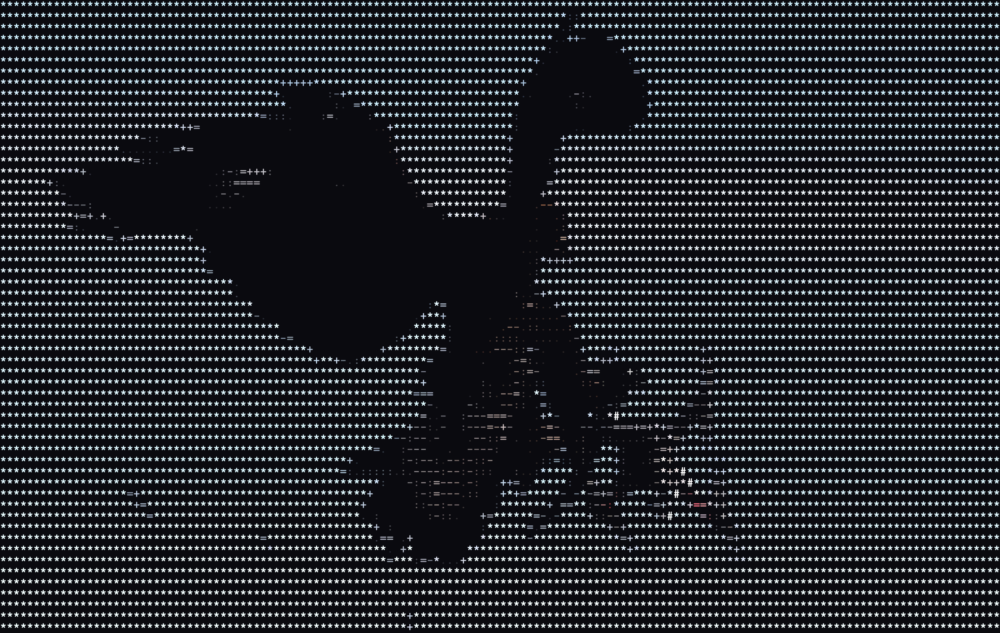
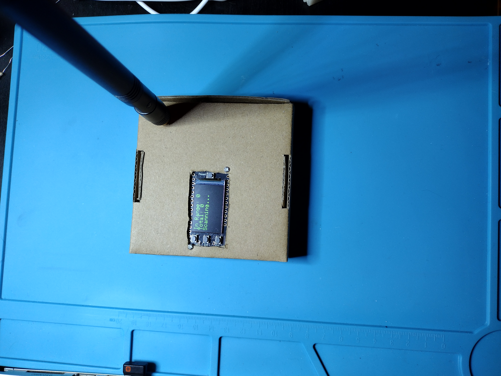
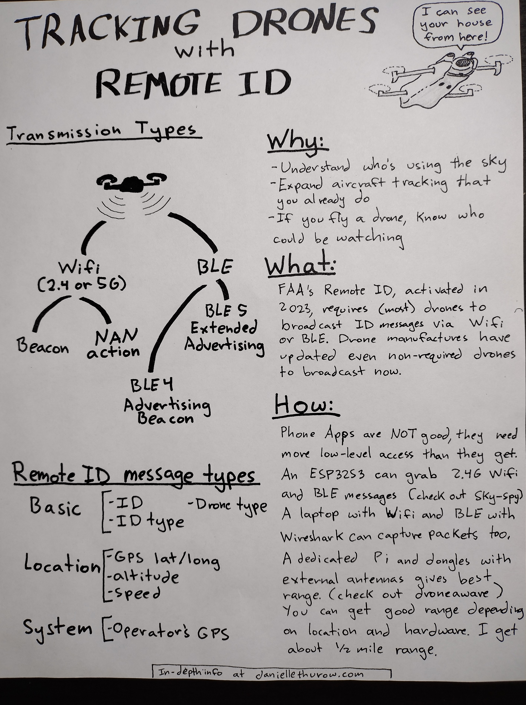
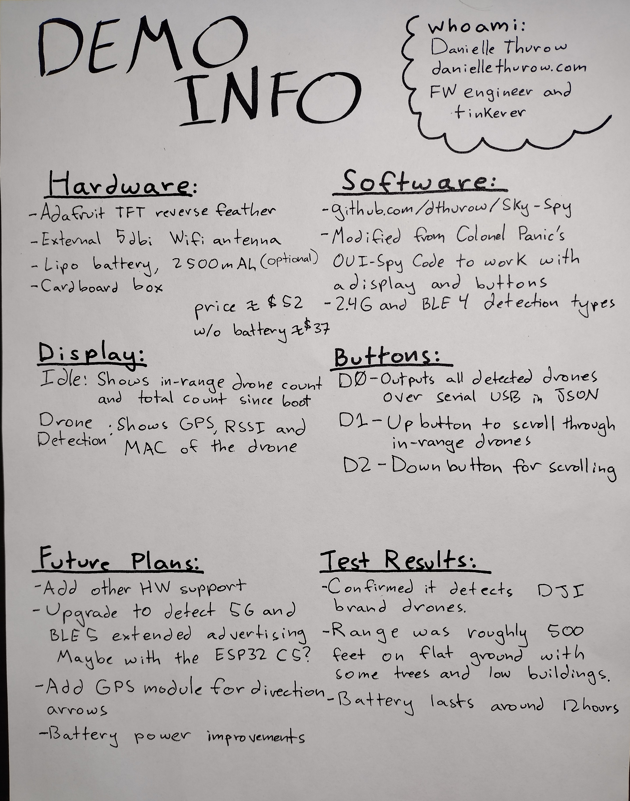
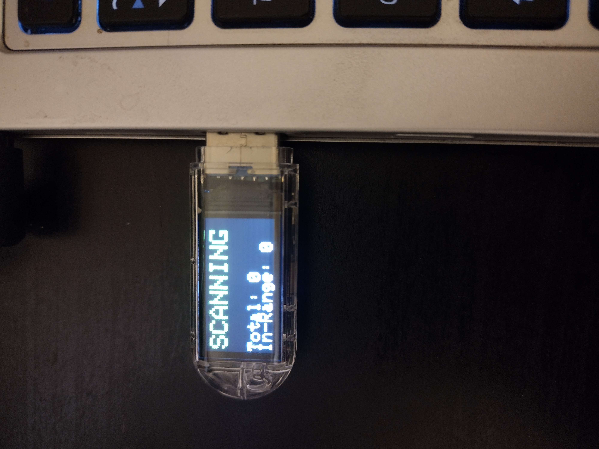

Since I [already talked]() about the Remote ID protocol and how it was broadcast, you might now want to actually _listen_ to those Remote ID messages around your home. There's certainly commercial-grade solutions for that, but maybe you don't want to drop a thousand dollars or book a meeting with a company so you can buy it, all for a fun sidequest. Instead, lets look for some slightly cheaper and easier to access options, and see what Remote ID functionality they support, and what they don't. 

First up: The first drone detection hardware/firmware I came across, Colonel Panic's [Sky-Spy](https://github.com/colonelpanichacks/Sky-Spy)! I'll review the hardware and firmware functionality, how to DIY the hardware if you're feeling cheap, and include a bonus of some forked code that I've started working on!

...I had originally planned on doing one overview post of all current available options...but then I got nerdsniped. So I'll be going more in-depth on each.




<!--more-->

> **NOTE** Highly recommend reading my previous post about the remote ID transmission types, if you haven't already. This post assumes you know about that already.

## Overview - Functionality and Code Review

[Colonel Panic](https://colonelpanic.tech/) has several fun pieces of hardware, including their OUI-SPY, which was originally setup as a general BLE scanner, but was re-purposed by them as a drone detector as well. The custom hardware currently uses a Xiao ESP32-S3, a piezo buzzer, and custom PCBs to make a nice little handheld device. They used their hardware with a custom code base called [Sky-Spy](https://github.com/colonelpanichacks/Sky-Spy) (The image above is the logo from that firmware). Colonel Panic has a lot of other cool firmware setup for the OUI-Spy as well, such as the [Unified Blue](github.com/colonelpanichacks/oui-spy-unified-blue) firmware that combines a lot of different functionality into one codebase.

 In the previous post, I talked about all the potential ways drones can broadcast: BLE 4 and 5 advertising packets, and 2.4/5G Wifi beacon and NAN frames. Based on my research, the OUI-Spy covers 3 out of possible 6 transmission types. How do I know? By looking at the current hardware and firmware. Lets take a look!

> **NOTE** They're pretty active with development, so some of my research may be moot soon. **BUT** if you know how and where to look for this info now, you'll be able to take a look at the latest code and compare!

### BLE 4 and 5

For BLE, we first check if the hardware can handle 4 and 5, then look at the code. The hardware is easy, espressif specifically says ESP32S3's can use both BLE 4 and 5. 

For the firmware side, we can see it's using pretty standard espressif setup for BLE advertisements. However, it's not setup for the BLE 5 extended advertising packets, which can be checked by looking at the BLE 5 example code from espressif.


> **Want to look at the code and follow along?** The main Sky-spy code can be found here: [https://github.com/colonelpanichacks/Sky-Spy](https://github.com/colonelpanichacks/Sky-Spy)


Here's the callback in Sky-Spy:
```c++
class MyAdvertisedDeviceCallbacks : public BLEAdvertisedDeviceCallbacks {
public:
  void onResult(BLEAdvertisedDevice device) override {
    int len = device.getPayloadLength();
    uint8_t* payload = device.getPayload();
    // payload parsing removed here for brevity...
  }
};
```

And the BLE initialization in Sky-Spy:
```c++
  BLEDevice::init("DroneID");
  pBLEScan = BLEDevice::getScan();
  pBLEScan->setAdvertisedDeviceCallbacks(new MyAdvertisedDeviceCallbacks());
  pBLEScan->setActiveScan(true);
```

Lets compare that with the Espressif example code for extended advertising.

> **NOTE** The example code lives here:
[https://github.com/espressif/arduino-esp32/blob/master/libraries/BLE/examples/BLE5_extended_scan/BLE5_extended_scan.ino](https://github.com/espressif/arduino-esp32/blob/master/libraries/BLE/examples/BLE5_extended_scan/BLE5_extended_scan.ino)


Here's Espressif's callback, note it's inheriting from a differenc class, `BLEExtAdvertisingCallbacks`, and the `onResult` argument type is different:
```c++
class MyBLEExtAdvertisingCallbacks : public BLEExtAdvertisingCallbacks {
  void onResult(esp_ble_gap_ext_adv_report_t report) {
    if (report.event_type & ESP_BLE_GAP_SET_EXT_ADV_PROP_LEGACY) {
      // here we can receive regular advertising data from BLE4.x devices
      Serial.println("BLE4.2");
    } else {
      // here we will get extended advertising data that are advertised over data channel by BLE5 devices
      Serial.printf("Ext advertise: data_le: %u, data_status: %u \n", report.adv_data_len, report.data_status);
    }
  }
};
```

And here's the initialization for extended advertising, note it's setting the extended scan functions:
```c++
 BLEDevice::init("");
  pBLEScan = BLEDevice::getScan();  //create new scan
  pBLEScan->setExtendedScanCallback(new MyBLEExtAdvertisingCallbacks());
  pBLEScan->setExtScanParams();         // use with pre-defined/default values, overloaded function allows to pass parameters
  delay(1000);                          // it is just for simplicity this example, to let ble stack to set extended scan params
  pBLEScan->startExtScan(scanTime, 3);  // scan duration in n * 10ms, period - repeat after n seconds (period >= duration)
```

So this research shows: **Sky-Spy is capturing the BLE standard advertising packets, but not the extended ones**.

However, the espressif example appears to get both legacy and extended advertising, which means this hardware could actually capture both. I plan on looking into this for my custom fork of this code (more below).


### 5G Wifi

For determining if it supports 5G, we once again start with looking at the hardware. The ESP32-S3 hardware fact sheet shows it does not support 5G wifi. So this research shows: **The ESP32-S3 only has 2.4 GHz Wi-Fi and BLE 5**. 

The new [ESP32-C5](https://www.espressif.com/en/products/socs/esp32-c5) _does_ support 5GHz wifi, and according to Espressif is the "first RISC-V MCU that supports 2.4 and 5 GHz dual-band Wi-Fi 6, along with Bluetooth 5 (LE) and IEEE 802.15.4 (Zigbee, Thread) connectivity". So this may be a hardware upgrade for the future. And in fact Colonel panic's repo has a sub-folder that looks to include some work done on the XIAO seeed ESP32C5 [https://github.com/colonelpanichacks/Sky-Spy/tree/main/xiao-c5-5g](https://github.com/colonelpanichacks/Sky-Spy/tree/main/xiao-c5-5g). So maybe this is a future upgrade for OUI-Spy?


### 2.4G Wifi

We've already confirmed the ESP32S3 has 2.4 GHz Wi-Fi, so lets jump right to the firmware. Here we have to confirm both NAN and beacon frames are parsed.

First, the initialization, setting up the wifi module to be in promiscuous mode and scanning Channel 6:

```c++
  WiFi.mode(WIFI_STA);
  WiFi.disconnect();
  
  esp_wifi_set_promiscuous(true);
  esp_wifi_set_promiscuous_rx_cb(&callback);
  esp_wifi_set_channel(6, WIFI_SECOND_CHAN_NONE);
```

Looking at the `callback` function it references, it checks the packets to see if they're NAN or beacon and parses them as needed (snippet below). The first `if` statement short circuits if the wifi packet isn't a management packet. It then checks if the destination address is the expected NAN address, or if the management frame's type is `0x80`, the beacon type.

```c++
void callback(void *buffer, wifi_promiscuous_pkt_type_t type) {
  if (type != WIFI_PKT_MGMT) return;
  
  wifi_promiscuous_pkt_t *packet = (wifi_promiscuous_pkt_t *)buffer;
  uint8_t *payload = packet->payload;
  int length = packet->rx_ctrl.sig_len;
  
  static const uint8_t nan_dest[6] = {0x51, 0x6f, 0x9a, 0x01, 0x00, 0x00};
  if (memcmp(nan_dest, &payload[4], 6) == 0) {
    if (odid_wifi_receive_message_pack_nan_action_frame(&UAS_data, nullptr, payload, length) == 0) {
      // parsing removed for brevity...
    }
  }
  else if (payload[0] == 0x80) {
   // parsing removed for brevity...
  }
}
```

Using those two things as the way to check for NAN or Beacon frames is a bit odd, but does show **Sky-Spy parses Wifi NAN and Beacon Frames in 2.4G Wifi**.


### Parsing Remote ID protocols

Something I like about this codebase is that it uses the open remote ID library: [https://github.com/opendroneid/opendroneid-core-c](https://github.com/opendroneid/opendroneid-core-c) for parsing the received messages. This parsing library was originally put together by Gabriel Cox, who was "leading the ASTM UAS Remote ID workgroup (as Chairman) consisting of industry and government stakeholders to bring a consensus standard solution and Means of Compliance (MOC) for Remote ID." (quote pulled from [his company website](https://coxdatalabs.com/about/)). It also claims in the README to be compliant with the updated F3411-22a, the version of the specification that currently does not appear to be available online unless you pay ASTM for the pleasure.

I wanted to call this out specifically, because some other solutions look to use custom parsing instead of a library, which has its own trade-offs.

### Sky-Spy Functionality Conclusion

You can see above then that the Sky-Spy firmware and the OUI-Spy can detect a subset of ways the drones transmit remote IDs: BLE 4, and 2.4G Wifi Beacon and NAN frames. This means, for example, DJI drones that broadcast on 2.4G Wifi will be heard, but Skydio drones that use 5G-only will not. With the custom hardware currently $85 on Colonel Panic's website, that may be too steep a price for you, for the functionality given. If you're feeling handy (which you may be, since you're reading this), I do want to mention Colonel Panic does give enough info you can do a DIY OUI-Spy device, which may make the trade-off worth it for you.

## Setup with DIY Hardware

When I was first interested in this, the [official OUI-Spy Hardware](https://colonelpanic.tech/) was estimated a month or so out. However, Digikey sells the parts that Colonel Panic mentions as a DIY option, and has a much faster turnaround. So with a little bit of perf board and soldering, I had a functionally-identical bit of hardware that cost roughly 10 dollars and arrived faster. Downside, of course, is that I had to do a lil bit of soldering and firmware flashing. Luckily, that's my jam. 

I picked up a 3-pack of the ESP32S3's, since it was a bit cheaper per-board: [https://www.digikey.com/en/products/detail/seeed-technology-co-ltd/102010573/24814471](https://www.digikey.com/en/products/detail/seeed-technology-co-ltd/102010573/24814471)

And piezo buzzers are pretty interchangeable, but I grabbed these: [https://www.digikey.com/en/products/detail/tdk/PS1720P02/935932](https://www.digikey.com/en/products/detail/tdk/PS1720P02/935932)

Then you just connect the buzzer to the ESP32-S3 on the right pins (ground and the pin the firmware uses). To keep it all together, I used a small chunk of [bakelite perf board](https://www.adafruit.com/product/2670) I had bought ages ago from adafruit, and some solid core wire. I routed the wire under the ESP32-S3, so it was as small of footprint as I could make it. 


| ESP32-S3   | Connection |
|------------|-------------|
| GPIO Pin 3 | Piezo Buzzer |
| Ground     | Piezo Buzzer|


With the hardware put together, I just had to flash the firmware onto it. I had to make sure VSCode was installed, and the platform IO extension was loaded in VSCode. Then I cloned the Sky-Spy repo, and did a basic platform IO build and upload, while my device was plugged in with a data USB-C cable. And voila, a functioning drone detector!

Below are some pictures of my final product! 

> **Note** I've added a larger antenna as my external antenna for the Wifi, since I had one lying around. You can just use the small antenna that comes with the Xiao ESP32-S3, you'll probably just get a smaller range with it.


And the back side to see my "better than good, it's good enough" soldering on the bit of perf board I used:


## My Modified Codebase

I can never leave well enough alone, so I forked Colonel Panic's codebase and started adding support for other hardware types. Codebase is [here](https://github.com/Dthurow/Sky-Spy). So far I've added and tested the Adafruit TFT reverse feather and a Lilygo T Dongle S3.

I also plan to upgrade the codebase to support both legacy and extended advertising BLE packets. As well as take some of the code changes from the [Flock-you](https://github.com/colonelpanichacks/flock-you) codebase that Colonel Panic also made. Mainly writing to memory for detection retention through power-loss.

### Firmware Change 1 - Add support for a display
I've updated the code to use a `DisplayHandler` interface that gets implemented by the specific bits of hardware. This then lets the `main.cpp` pull in the correct implementation at the top, and then just use the interface functions to interact with it in the code. This cuts down on the number of `#ifdef`s in the code and makes it easy to add more hardware going forward. So for example, my Adafruit board creates a class `Display_TFT_Reverse_Feather` to implement the `DisplayHandler`.

The interface has a couple standard functions:
- Idle function, when I simply want to say it's scanning, plus total detections and how many are in range currently
- Detection function, when it shows drone information (MAC, RSSI, GPS)
- Info function, for just general info updates that aren't the above two options
- Initialization function, for configuring the hardware for that particular board

For the implemntation on the feather, I used Adafruit's example code a lot, using their custom TFT library, and it was pretty straightforward. 

For the implementation on the lilygo, I used the [Bodmer TFT_eSPI](github.com/Bodmer/TFT_eSPI) library, which was a bit of a bear to get working correctly. Selecting the configuration for the library felt confusing, and the current configuration for the lilygo t dongle doesn't actually work with my hardware. I was using platform IO, which auto downloads the library for me, but then I had to modify my build flags so it used the correct configuration file (`TFT_eSPI/User_Setups/Setup209_LilyGo_T_Dongle_S3.h`), plus a bonus definition because my dongle apparently doesn't match the standard setup (`-DUSE_HSPI_PORT`). Once I _finally_ figured that out, the rest of the display implementation went quickly.

### Firmware Change 2 - Add support for buttons
This currently assumes that if the buttons are enabled (via the `BUTTONS_ENABLED` definition), there will be 3 of them in a certain configuration (i.e. the reverse feather's configuration). Eventually I'll probably abstract things out similar to how the display is done above.

My code sets up interrupts on button presses, that feed to a queue that periodically gets serviced by the rtos task `interactionTask`. There's a mini state machine there that sets up two buttons as a scroll up and scroll down button, with another one as a "detection dump" button. The scroll buttons lets you scroll between the currently in-range drones, looping back to the idle state when you finish. 

The detection dump button triggers outputting all detections as json over serial. This supports using the reverse feather with a battery while you're out and about, then when you get home, plug in the USB-C to your computer, open a serial connection, and press the button. Ta-da, all detections have been copied over! This isn't maintained during power off events, but hey, it's better than nothing.

### Hardware - Adafruit TFT reverse feather

This gives a display to play with, to show drone detections immediately, some buttons, and of course an external antenna option. If you wanted, you could keep the buzzer by buying one and wiring it up to a free GPIO, there's definitely room, but I haven't gotten around to that yet, I was too excited by the display.

Here's a link to the hardware list on adafruit: [https://www.adafruit.com/wishlists/622656](https://www.adafruit.com/wishlists/622656). The total is about 48 dollars, but if you want to skip the battery, or buy the internal antenna option, you could cut the price down considerably. Though this comes with functionality trade offs, of course.

A nice benefit from using the Adafruit TFT reverse feather is that it comes with a battery charger chip onboard, and a JST connector for a lipoly battery. Which means it's super easy to power with _either_ an external USB-C connector, or with an internal battery, for portability. I'm currently using the very advanced prototyping functionality of "cardboard boxes" to create a custom enclosure for this hardware, but someone with 3d printing knowledge could probably knock out a slick case for it pretty fast. 

Here's some pictures of that current setup:




#### Teardown Conference
I took this custom setup to [Teardown 2026](https://www.crowdsupply.com/teardown/portland-2026) and just had it out on a table with little infographics for part of the conference. I've included the infographic images below if you're curious!





> **NOTE** Teardown is a super fun conference, highly recommended

### Hardware - Lilygo T Dongle S3

The [Lilygo T-Dongle-S3](https://www.microcenter.com/product/703093/lilygo-t-dongle-s3-esp32-s3-ttgo-development-board-with-screen) is another setup that gives me a display, but the biggest plus is the cute thumbdrive form factor, and how it was in stock at my local Microcenter so I could impulse buy it. Current cost was about 20 bucks (looks like direct from lilygo you can get it for cheaper). It has a built in antenna, but interestingly, there's an option to update it to use an external antenna. The iPex connector is on the board, just disconnected, so you have to remove a 0 ohm resistor from one place and bridge two solder pads in another place, then boom, external antenna support. The snap on plastic case also snaps off pretty easily, from my experience, so this seems like a pretty easy process. I haven't done more than taken a look though, so there may be some hidden issues there.



Another benefit of this is that it has a built in spot for a tiny SD card, funnily enough **inside** of the USB plug. This can be super useful for keeping data through a power off event, and is one of the reasons I want to look into saving detections to SD cards.


## Current Detection Results

A neighbor was kind enough to fly a drone around for me, to let me test out some ranges of different solutions. He had a DJI drone, and we tested it around my neighborhood, which is relatively flat, with 2-story buildings and some trees. This is important context since wifi and bluetooth are both affected by things in the way, so if you live someplace where there's no trees and hills, you'll get better range than, say, hilly and tree-covered seattle. Where and how big the antenna is will affect range too. If you or the drone are higher up, you'll get a better line-of-sight (or line-of-signal, I suppose) and so better range.

With my smaller antenna, at ground level, with the drone flying between 100 and 300 feet above ground level, my sky-spy setup can detect drones about 500-800 feet away consistently.

This is one day of testing, so there's definitely wriggle room in that number, but it feels very promising considering I hadn't tested if it worked at all yet! 

There's other drone detection setups out there (though not that many), but this project has a relatively low cost of entry with decent range of detection. I feel either Colonel Panic's or my codebase will continue to improve, too, making it a project to watch. 

## References

Colonel Panic: [https://colonelpanic.tech/](https://colonelpanic.tech/)

Sky-Spy: [github.com/colonelpanichacks/Sky-Spy](github.com/colonelpanichacks/Sky-Spy)

My Modified codebase: [https://github.com/Dthurow/Sky-Spy](https://github.com/Dthurow/Sky-Spy)

Adafruit TFT reverse feather drone kit: [https://www.adafruit.com/wishlists/622656](https://www.adafruit.com/wishlists/622656)

Lilygo T Dongle S-3: [https://www.microcenter.com/product/703093/lilygo-t-dongle-s3-esp32-s3-ttgo-development-board-with-screen](https://www.microcenter.com/product/703093/lilygo-t-dongle-s3-esp32-s3-ttgo-development-board-with-screen)

open remote ID library: [https://github.com/opendroneid/opendroneid-core-c](https://github.com/opendroneid/opendroneid-core-c)