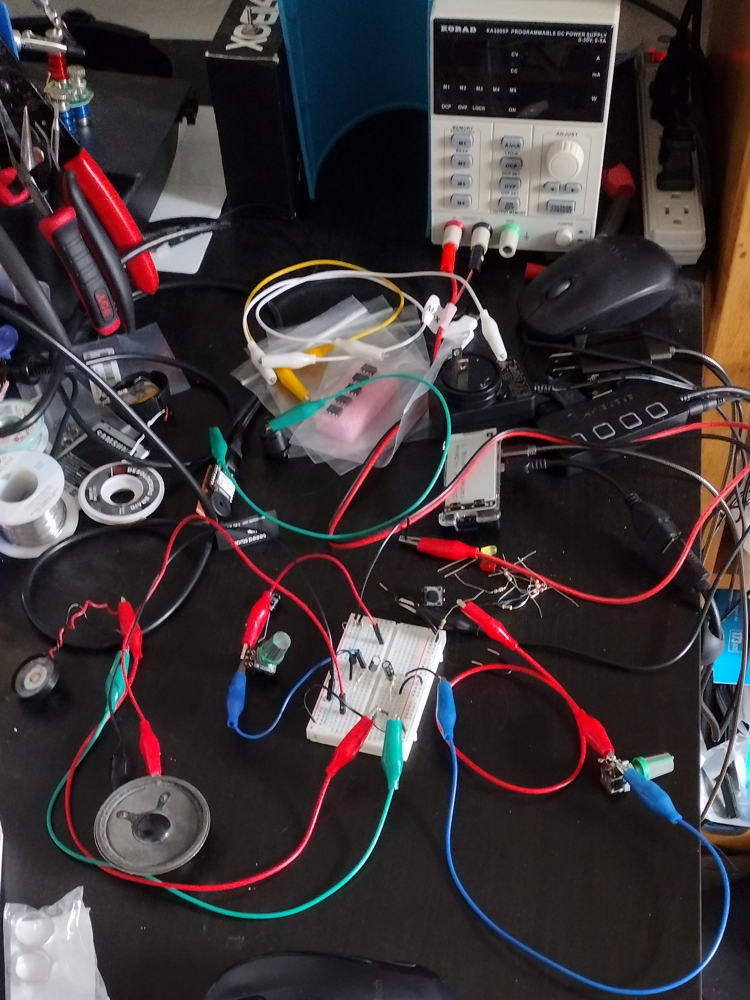
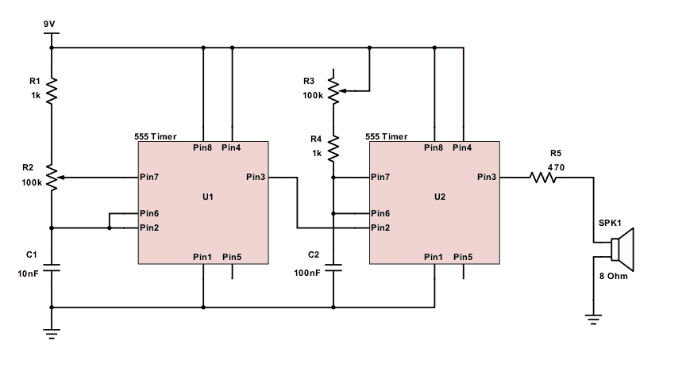
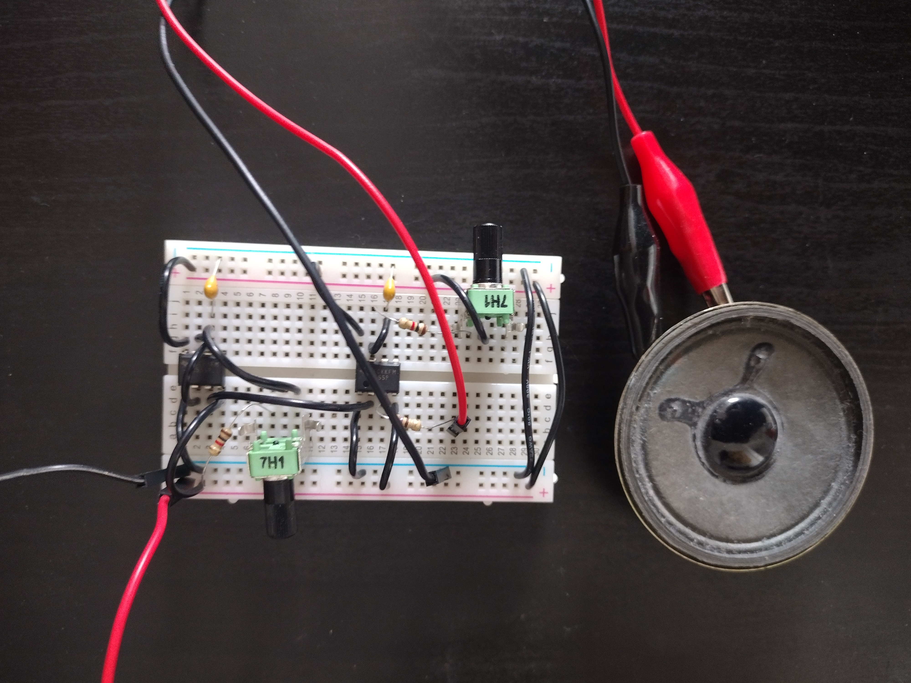
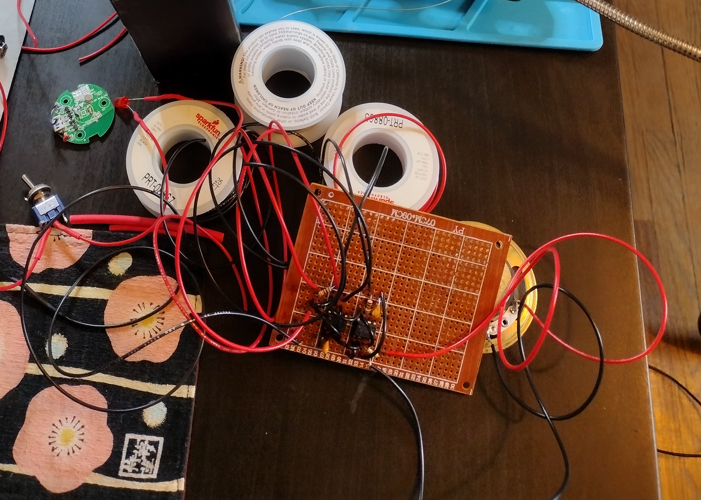
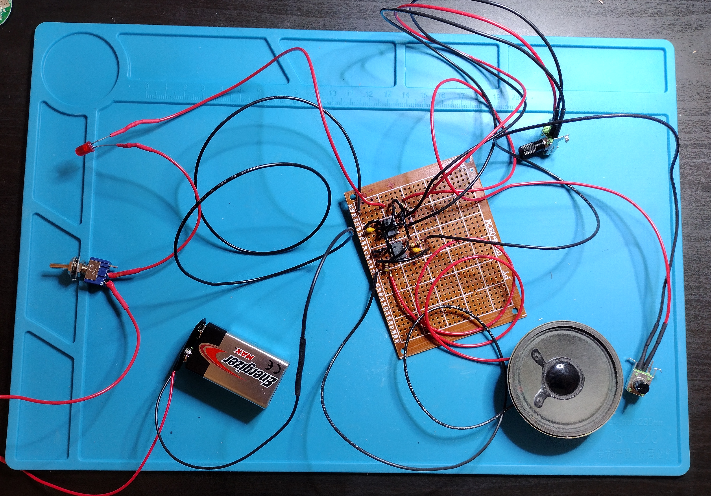
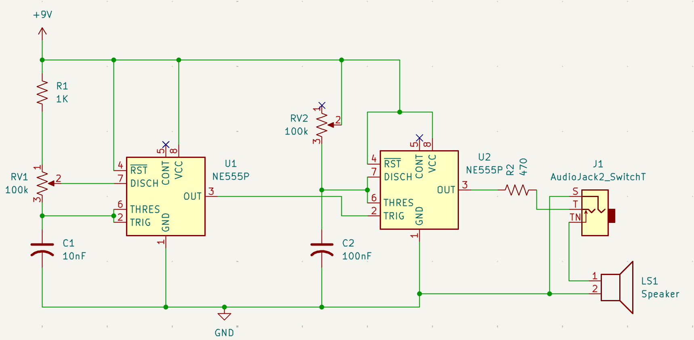
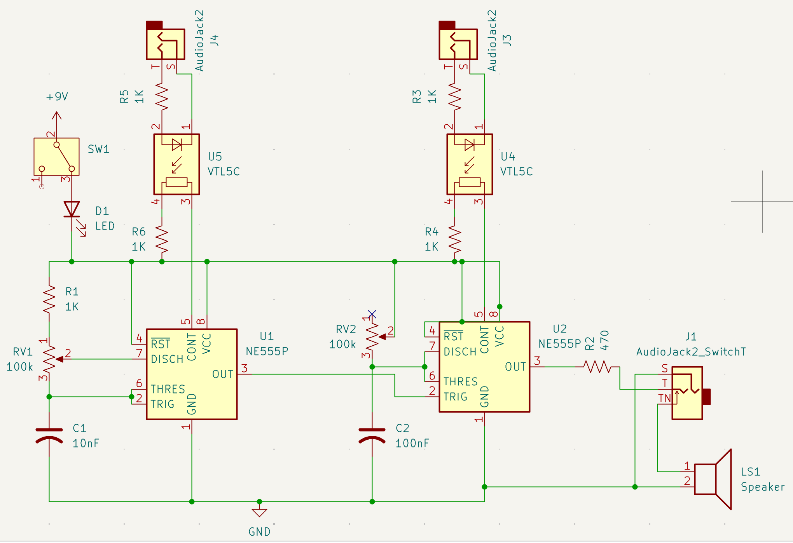

* TOC
{:toc}

You ever feel like you just want to make some noise? Maybe a horrendous noise? And you want to use electronics to do it? Well do I have some fun projects for you, lets dive into the world of simple analog noise makers!

<!--more-->

# Overview

Nowdays most intro-to-sound tutorials will have you grab an arduino or other microcontroller and a speaker, but _back in the day_, things were still analog. No computer, just a bunch of electrical components to use (or abuse) to create oscillating voltages with different frequencies to make sound. This eventually branched out into synthesizers and electronic music we've all come to know and love. But you don't _have_ to drop [$450 on an analog synthesizer](https://www.perfectcircuit.com/korg-monologue.html) in order to make some loud, synth-like sounds.

# The most basic - Super Simple Oscillator

Probably the simplest I've found is this super simple oscillator from [Look Mum No Computer](https://www.lookmumnocomputer.com/simplest-oscillator/). This is created by abusing a poor transistor that doesn't know whats coming for em. 

## How it works

The basic concept has you hook up a transistor's collector and emittor **backwards** in the circuit, in parallel with a capacitor, with a resistor in series. And just to be even meaner to the transistor, you cut off the base middle pin (this helps prevent it from interfering with your shenanigans). The battery charges up the capacitor while the transistor basically has nothing flowing through it because it's backwards. Once the capacitor reaches the right level of voltage, though, it triggers an "avalanche" in the transistor, where it suddenly has very low resistance. The capacitor discharges through the transistor until its voltage is lower than that trigger point, and the circuit goes back to its original state, with the capacitor charging up. This repeats, and you get some oscillation, and therefore, noise! If instead of a single resistor, you do a resistor plus potentiometer, you get the ability to control how fast the capacitor charges, and therefore the frequency of the oscillation.

The fun part of this circuit is: 

- if you have any sort of component collection, you probably already own all the parts for it (I did!) 
- exactly which value of each component is super loose. You can use different NPN transistors, which will trigger at different voltages. You can use different sized capacitors, which determine the baseline frequency your pot is changing. You can add an LED, or not. 
    
After playing around with it, it kind of felt like you could just throw a handful of random components on it, and it'd somehow still oscillate. Fun stuff! I messed around with this circuit a lot on my breadboard, and did some double oscillator for two tones sort of thing as well:

However, there's definite limitations to what sort of sounds you can get out of it. So let's go a little bigger.

# Next Step Up - Atari Punk Console

While it's not individual components, a classic 555 timer chip counts as analog to me. So how about two of them? Lets build the Atari Punk Console. 

> **NOTE** There's a _lot_ of different circuits and walk throughs online. If you want to see how variable they can be, it's fun to compare the circuits with different values and compare/contrast. Well, fun to me, anyway.

## How it works

I ended up using the circuit from this website: 
[https://www.build-electronic-circuits.com/atari-punk-console/](https://www.build-electronic-circuits.com/atari-punk-console/)

Mainly because it included some resistors that other versions lack. For example without, look at [the circuit this user built on electronics stack exchange](https://electronics.stackexchange.com/questions/102592/problems-with-atari-punk-console-circuit ). This version of the Atari Punk Console has the second potentiometer conect the power source to pin 7 on the second 555 with no resistor in series. So if the potentiometer is turned all the way down, the resistance is 0 and the pin is getting full power. So when the 555's internal transistor discharges through the chip, it's just shorting out. Schematic shown below.

> **Fun Fact** Creating shorts across your battery is not good!

The linked stack exchange talks about what happens then, the timer gets very hot or even melts. Not so good for music making.

Throwing in a few resistors so there's always _some_ resistance on the connections between power and the potentiometer seemed like a good thing, so I went with that version. I also wanted a way to turn it off when I was done, though, so I added a switch and LED in-line with the power. The base schematic I ended up using:

## My Build

After spending a concerningly long time at our local surplus store with a huge electronic component selection ([Ax-man surplus](https://www.ax-man.com/), how I love you), I had everything I needed.

I translated the schematic to a breadboard for initial testing, and it came together suprisingly easily.

Once I had proof of concept, I converted it over to a perfboard with soldered connections for a more permanent setup. Below are my in-progress photos as I went.

Getting started:

Partially finished with the perfboard layout, and a lot of messy long wires:

All the components soldered together and working! Now I just need an enclosure...

I had a hackerbox subscription a while back, and their kits come in fun skull-and-circuit decorated boxes. Which seemed perfect for something called a _punk_ console:

And just like that, the first version of the Atari Punk Console was done! But, well, we can do better, now can't we...

## Modifications

### Switching Headphone Jack

My partner occasionally works from home. It turns out listening to loud annoying sounds repeatedly gets annoying. So I modified the original schematic to include a switching audio jack, courtesy of ax-man surplus. The jack is a standard headphone jack, and it has 3 connection points. When there's no headphones plugged in, electricity will go through one path, and when headphones are plugged in, it goes through a different path. So if it's spliced into the path to the speaker, I can set it up so when I plug in headphones, it goes through my headphones, and when I unplug them, it goes back out through the speakers. 

I can now listen to my atari punk console quietly! Schematic change:

### CV Control

The 555 chip has a CV pin right on it, pin 5, which isn't used at all for most atari punk consoles I've seen. However, it is possible to add that functionality pretty easily. This allows you to add some audio jack plugs that, when connected to an appropriate control voltage source (e.g. certain sythensizers), can control the exact tone you get. The addition is shown below.

As you can see, it's adding a vactrol connected to an audio jack on one side, and the CV voltage pin on the other. The vactrol is just a photoresistor and an LED, so as the voltage goes up, the LED gets brighter, and the photoresistor changes resistance. The end result becomes: "Voltage change from the CV input results in a voltage change on the CV pin". But with bonus that it keeps the atari punk console isolated from whatever is plugged into the CV input jack, since only light is being sent between the CV jack and the atari punk console. 

Now, I didn't actually buy a fancy vactrol chip or anything, and instead did the DIY version. This can be made by using a photoresistor and a LED, with some heat shrink to hold them together and keep out any light. And tada, vactrol!

> **NOTE** If you learn better via video, you can see Look Mum No Computer make one here: [https://youtu.be/Ch9w5JtbZSc?si=L04PQ_3qpAdYQGnf&t=215](https://youtu.be/Ch9w5JtbZSc?si=L04PQ_3qpAdYQGnf&t=215)

## Final Results

With some small mods to the enclosure, my new and improved atari punk console was complete! The two CV input jacks I put on the left hand side, with the headphone out jack in the lower right with a little label, so I didn't forget which was which. I also added some cuts with an xacto knife over where the speaker was mounted in the upper right, to stop the cardboard from muffling the sound. And since I just free-handed it, that certainly gives it a, shall we say, _punk_ aesthetic. 

And if you want to hear what noises it can play, here's a short recording. I'm simply turning the potentiometers in various ways to get the different tones. 

<audio controls>
  <source src="/assets/atari-punk-console/atari_punk_console_basic_sound.mp3" type="audio/mpeg">
  Your browser does not support the audio element.
</audio>

## Next Steps

I started to play with the CV input, enough to prove it _can_ control the 555 timers. However, I got distracted and decided to try building a 8-step sequencer to work with the atari punk console, and then started debating about adding a gate control so the sound on/off can be controlled by a separate syth of some type... So maybe that will be some future blog posts! In the meantime, I'll just occasionally pull this out when I feel the need to make some good buzzy analog sounds.

# Resources

TI's 555 timer documentation: [https://www.ti.com/lit/ds/symlink/lm555.pdf](https://www.ti.com/lit/ds/symlink/lm555.pdf)

Atari Punk Console Schematic [https://www.build-electronic-circuits.com/atari-punk-console/](https://www.build-electronic-circuits.com/atari-punk-console/)

Look Mum No Computer Super Simple Oscillator: [https://www.lookmumnocomputer.com/simplest-oscillator/](https://www.lookmumnocomputer.com/simplest-oscillator/)

Look Mum No Computer DIY Vactrol explanation: [https://youtu.be/Ch9w5JtbZSc?si=L04PQ_3qpAdYQGnf&t=215](https://youtu.be/Ch9w5JtbZSc?si=L04PQ_3qpAdYQGnf&t=215)
