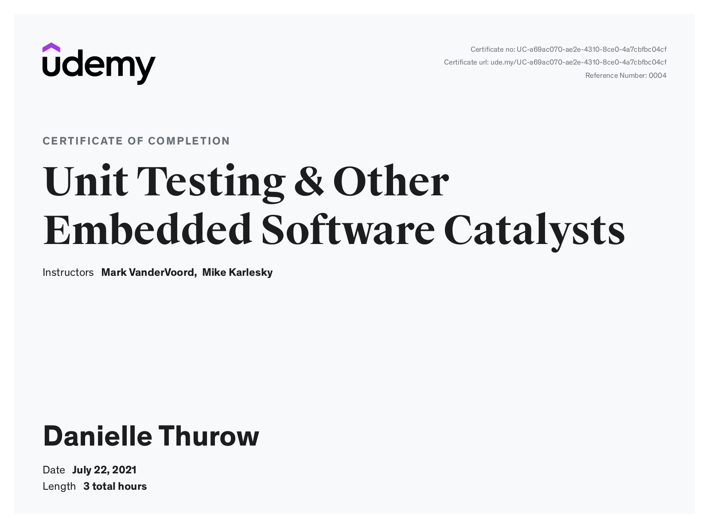

I graduated from Western Washington University March 2015 with a BS in CS and a minor in math, and have been moving closer to the hardware ever since. I've recently gotten an Electronic Technician Certificate from Hennepin Tech and been enjoying volunteering at Fixit Clinics in my city, as well as getting into radio communications like lora or ham radio.

In my spare time, I play with infosec, reverse engineering, radio frequencies, and whatever else catches my fancy.

## Education

### Degree and Certs

**Bachelors of Science in Computer Science with a Minor in Mathematics**
* from Western Washington University. Graduated March 2015 with 3.5 GPA

**Electronics Technician Certificate**
* from Hennepin Technical College, May 2026

## Personal Projects

### Embedded

* Did a deep dive into [Remote ID for tracking drones]()
* Set up an [ADSB Flight Tracker feeder node]()
* Made a [noise maker using 555 timers]()
* Programmed an ATmega328p from an Arduino Uno, without using the Arduino ecosystem
    * [Taking it off the Uno and using a programmer]()
    * [Getting rid of the Arduino IDE]()
* Did some intro reverse engineering of a modem 
    * [Explored the software]()
    * [Found test ports and got a serial command line with bus pirate]()
* Completed Udemy course on [Unit testing and the Unity framework](https://www.udemy.com/course/unit-testing-and-other-embedded-software-catalysts/), written by the authors of [Throw the Switch](http://www.throwtheswitch.org/), a community that "wants to unleash the awesomely flexible power of C on our Embedded Systems without fearing the dangers"

## Work

### Senior Firmware engineer
**2024 through 2025**

- Worked on Zephyr and Free RTOS projects
- Led a deep-dive in CAN Hardware configuration to improve CAN FD comms
- Firmware testing automation work with pyVISA and SCPI
- Member of Modernization working committee

### Firmware Engineer II and Senior Firmware engineer
**2021 to 2024**

Work Included
- Developing on Arm Cortex-M CPUs to make bare-metal C drivers for new custom hardware
- Unit testing and integration testing with C++
- Followed Class III medical device process and documentation requirements
- Lead dev on firmware for new technology research project using new BLE

### Freelance Software Developer
**2020 to 2021**

Worked with individual clients and non-profits to develop custom websites and applications to support their businesses. I do web development and  hosting work to create stable, simple solutions that do what my clients want, to enable them to keep their businesses working. 

### Senior Software Engineer
**2018-2019**

Work Included:
* building out a more automated build process for SPIE's websites
* Sole developer importing 500,000 XML files generated by hand over 20 years into a relational database
* wrote powershell scripts for automatically setting up dev VMs, refactored to be used for dev, test, and multiple VM environments
* developed and organized Confluence documentation to help on-boarding and knowledge transfer
* Member of interview team for other senior software engineers
* created take home project for senior, junior, and intern software engineer interviewees
* sole developer for initial refactor of business layer code to support new digital library clients

### Software Engineer
**from January 2015 to 2018**

Work Included:
* Full time initial dev for new Digital Library website, https://www.spiedigitallibrary.org
* Full stack developer for SPIE.org using C#, Razor, HTML, Jquery
* Data Layer DLL connecting with multiple SQL databases
* Develop plugins, workflows, web resources for Dynamic CRM using C#
* Set up ELK stack using Docker and VMs to push for Logging Visualization system
* Created and leading team to improve the software development lifecycle at SPIE via automation towards CI, CD, logging visualization and other process improvements.
* Create powershell scripts for managing data normalization